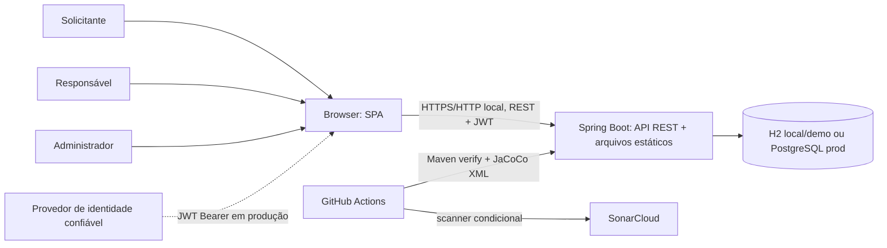

# Diagramas da Arquitetura

Os diagramas representam o código e a configuração atuais. `demo` e `local` usam H2; `prod` configura PostgreSQL e Flyway. O login por identificador existe apenas nos perfis locais/de demonstração.

## Contexto



## Componentes

```mermaid
flowchart TB
  subgraph Cliente
    SPA[SPA estática: auth, recursos, reservas, usuários, manutenção, relatórios]
  end
  subgraph SpringBoot[Aplicação Spring Boot]
    Sec[SecurityConfig: JWT Bearer, autorização, CORS]
    Auth[AuthController: login local/demo]
    Controllers[Controllers: Reserva, Recurso, Usuário, Manutenção, Relatório]
    Services[Services: Reserva, Manutenção, Relatório, conflito]
    Domain[Domínio + DTOs + validação]
    Repos[Repositories Spring Data JPA]
    OpenAPI[OpenAPI / Swagger]
    Seed[DataInitializer: apenas local/demo]
  end
  DB[(H2 local/demo | PostgreSQL prod + Flyway)]

  SPA -->|HTTP/JSON| Sec
  Sec --> Auth
  Sec --> Controllers
  Auth --> Repos
  Controllers --> Services
  Services --> Domain
  Services --> Repos
  Repos --> DB
  Seed --> Repos
  OpenAPI -. documenta .-> Controllers
```

## Sequência crítica — criação de reserva

```mermaid
sequenceDiagram
  actor U as Usuário autenticado
  participant SPA
  participant Sec as Security/JWT
  participant C as ReservaController
  participant S as ReservaService
  participant R as Repositories
  participant DB as Banco

  U->>SPA: Solicita reserva
  SPA->>Sec: POST /reservas + Bearer JWT
  Sec->>Sec: Validar assinatura, expiração e perfil
  Sec->>C: Requisição autorizada
  C->>C: Exigir SOLICITANTE e usar subject do JWT
  C->>S: criarReserva(request)
  S->>S: Validar intervalo
  S->>R: Buscar e bloquear recurso / agenda responsável
  R->>DB: Lock e leitura
  S->>R: Validar usuário e manutenção
  S->>R: Consultar conflitos do recurso/agenda
  alt Existe conflito
    S-->>C: ConflitoReservaException
    C-->>SPA: 409 Conflict; não persiste reserva
  else Sem conflito
    S->>S: Definir PENDENTE (restrito) ou APROVADA
    S->>R: Persistir reserva
    R->>DB: INSERT
    S-->>C: Reserva criada
    C-->>SPA: 201 Created
  end
```

## Sequência crítica — login local/demo

```mermaid
sequenceDiagram
  actor U as Usuário de demonstração
  participant SPA
  participant Auth as AuthController
  participant Users as UsuarioRepository
  participant JWT as JwtEncoder

  U->>SPA: Informa matrícula/e-mail
  SPA->>Auth: POST /auth/login
  Note over Auth: Ativo somente em local/demo; nunca em prod
  Auth->>Users: Buscar identificador
  alt Usuário não encontrado
    Auth-->>SPA: 401 Unauthorized
  else Usuário encontrado
    Auth->>JWT: Assinar subject, profile e expiração (HS256)
    JWT-->>Auth: Token de demonstração
    Auth-->>SPA: 200 + token
    SPA->>SPA: Guardar token na sessão da aba
  end
```
