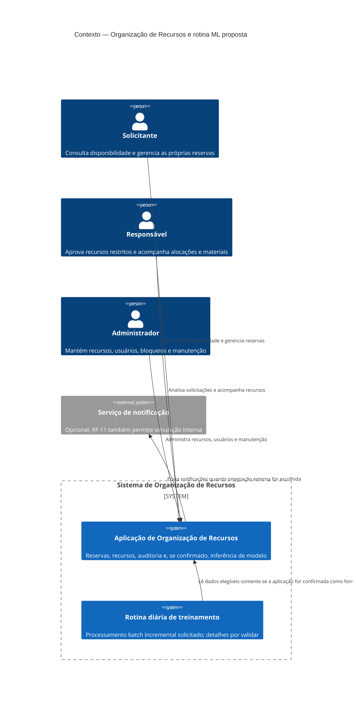
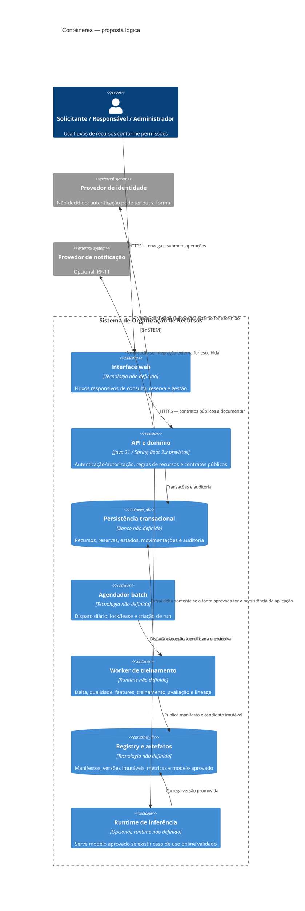
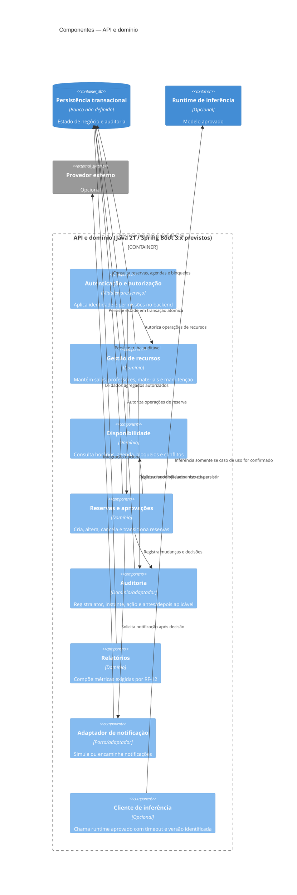
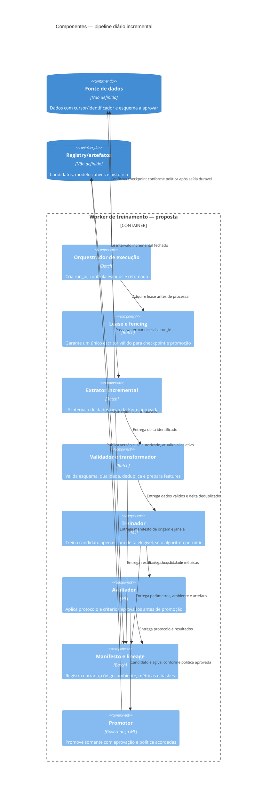
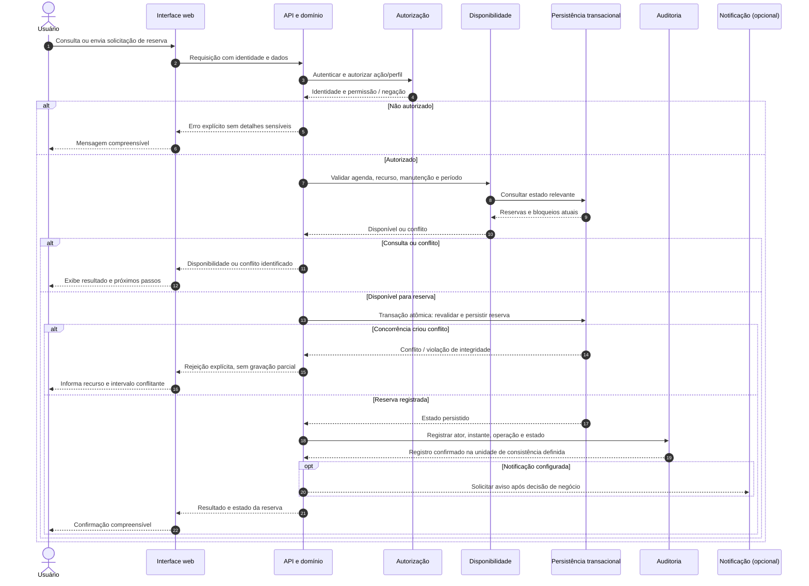

# Arquitetura — proposta complementar

> **Status: proposta para revisão; não aprovada como decisão de produto ou tecnologia.**
> Este artefato complementa [arquitetura.md](arquitetura.md), que permanece a fonte de
> verdade e não foi alterada. Requisitos e fatos abaixo são rastreados às fontes; as
> recomendações novas estão identificadas como propostas ou decisões sem requisito.
> Não há implementação de código nesta entrega.

## 1. Escopo, fontes e rastreabilidade

O baseline trata da aplicação de organização de salas, professores e materiais,
reservas, aprovações, manutenção e auditoria. A stack prevista é Java 21 e Spring
Boot 3.x, sem decisão documentada sobre banco, autenticação, implantação ou
integrações ([visão-geral.md](visão-geral.md), “Contexto técnico e entrega”).

O cron diário de treinamento/retreinamento usando apenas dados novos é uma
restrição explícita desta solicitação, não um RF/RNF validado. Não estão definidos
o caso de uso do modelo, sua fonte de dados, a definição de dado novo, o algoritmo,
os usuários de inferência nem critérios de promoção. A arquitetura de ML abaixo é,
portanto, uma proposta condicionada à confirmação de escopo, não uma afirmação de
que esses elementos já existem.

| Driver | Consequência arquitetural | Rastreabilidade |
|---|---|---|
| Evitar reservas conflitantes inclusive sob concorrência | Validar e persistir reserva atomicamente; impor a regra no limite transacional de persistência, não só na interface. | RF-04 a RF-06; RNF-02; regra crítica “Tempo e concorrência” em [visão-geral.md](visão-geral.md). |
| Aplicar identidade e permissões fora da interface | Autenticação e autorização no backend para cada operação protegida; auditoria de acessos negados. | RF-01; RNF-01. |
| Aprovar recursos restritos e bloquear manutenção | Manter regras de estado e disponibilidade no domínio transacional do backend. | RF-07 e RF-08. |
| Rastrear mudanças relevantes e preservar reservas iniciadas | Histórico associado às operações e mudanças de estado, com acesso autorizado. | RF-09 e RF-10; RNF-07. |
| Medir qualidade e desempenho com evidências | Interfaces testáveis, testes de integração concorrente e medição de JMeter; não implica metas de latência ainda ausentes. | RNF-03 a RNF-06; metas de cobertura da visão geral. |
| Executar treinamento diário somente com dados novos | Pipeline batch com corte incremental explícito, checkpoint, deduplicação, retomada e evidência da origem dos dados. | Restrição desta solicitação; detalhe operacional ainda sem requisito. |
| Ser responsivo e documentar os contratos públicos | UI desacoplada dos contratos de backend; documentação atualizada com os fluxos efetivamente implementados. | RF-13 e RF-14; RNF-08 e RNF-09. |

## 2. Responsabilidades e limites

### 2.1 Domínios e componentes lógicos

| Componente | Responsabilidades | Limites / não responsabilidades |
|---|---|---|
| Interface web | Apresentar consulta, reservas, estados, conflitos e feedback responsivo aos três perfis. | Não decide autorização final, disponibilidade, aprovação ou integridade; nenhuma regra crítica depende da UI. |
| API e domínio de recursos | Expor operações públicas; aplicar autenticação/autorização; coordenar regras de recursos, agenda, reserva, manutenção e aprovação; devolver erros de negócio compreensíveis. | Não aceita duas reservas conflitantes; não executa treinamento no caminho síncrono de uma requisição. |
| Persistência transacional | Persistir recursos, reservas, estados, movimentos e registros de auditoria com atomicidade e proteção contra concorrência. | Tecnologia, esquema e estratégia física de lock ainda não escolhidos. |
| Adaptador de notificação | Registrar e encaminhar notificações de estado, conflito e pendências. | Provedor externo não é obrigatório: RF-11 também admite notificação simulada. |
| Scheduler do batch | Disparar a execução diária no horário/fuso que vier a ser aprovado, obter exclusividade e criar um identificador de execução. | Não define sozinho o conceito de “dia” nem pode avançar o checkpoint de dados sem as condições de conclusão definidas. |
| Ingestão e preparação ML | Ler somente o delta elegível, validar esquema/qualidade, deduplicar, preparar features e produzir manifesto de dados do run. | Não deve ampliar silenciosamente a janela para dados antigos; não determina ainda quais campos são necessários ou legítimos. |
| Treinador e avaliador | Treinar candidato, calcular métricas acordadas e comparar com o modelo vigente usando uma avaliação reproduzível. | Não promove um modelo sem critérios e autoridade de aprovação definidos; algoritmo e métricas dependem do caso de uso. |
| Registry e armazenamento de artefatos | Manter versões imutáveis, metadados, lineage, estado de aprovação e referência ao modelo ativo. | É uma separação lógica; produto, fornecedor e política de retenção ainda não foram escolhidos. |
| Runtime de inferência (condicional) | Servir a versão aprovada somente se for confirmado um fluxo funcional que consome previsões. | Não se presume que reserva, busca ou alocação usem ML; não substitui regras determinísticas obrigatórias de conflito e autorização. |

### 2.2 Responsabilidades operacionais

Os perfis de produto existentes são Solicitante, Responsável e Administrador
([personas.md](personas.md)). Eles não estabelecem quem opera dados, aprova modelos
ou responde por infraestrutura. Para implantação, devem ser atribuídas
explicitamente as responsabilidades abaixo; os nomes são funções propostas, não
novas personas ou papéis aprovados:

| Função a atribuir | Responsabilidade operacional |
|---|---|
| Proprietário do produto/dados | Confirmar finalidade do modelo, dados permitidos, critérios de sucesso, retenção e autorização de uso. |
| Responsável por ML/dados | Manter pipeline, qualidade, features, avaliação, lineage e reprodutibilidade do treino. |
| Operação/plataforma | Agendamento, credenciais, capacidade, alarmes, recuperação e disponibilidade de API/worker/storage. |
| Aprovador de modelo | Autorizar promoção conforme critérios e processo que ainda precisam ser acordados. |
| Segurança/privacidade | Validar base legal, minimização, acesso, retenção, atendimento a direitos e controles LGPD junto às pessoas responsáveis. |

Separação de funções, níveis de aprovação e acesso são decisões abertas. Não se
deve conceder a todos os administradores de recursos acesso automático a dados de
treino ou ao registry.

## 3. Limites e contratos de interface

Os contratos abaixo são lógicos. RF-14 exige documentar os fluxos/contratos
públicos; formatos, endpoints, autenticação concreta e versões ainda devem ser
definidos antes da implementação.

| Interface | Consumidor → provedor | Contrato e garantias propostas | Estado |
|---|---|---|---|
| UI → API de recursos | Navegador → API | Operações de consulta, reserva, alteração, cancelamento e acompanhamento; identidade em cada chamada; erros de validação, autorização e conflito distinguíveis; documentar request/response e códigos. | Necessidade rastreada em RF-01, RF-03, RF-04, RF-13 e RF-14; protocolo/formatos em aberto. |
| API → persistência | Domínio → armazenamento transacional | Uma única unidade atômica para validar disponibilidade e persistir reserva/alteração e auditoria associada. Conflito concorrente produz rejeição explícita e sem gravação parcial. | Garantia requerida por RF-06 e RNF-02; banco e mecanismo de concorrência em aberto. |
| API → notificação | Domínio → adaptador | Evento com identificador, tipo, destinatário autorizado e referência da operação; falha de envio não deve desfazer uma reserva já confirmada. | RF-11 permite simulação ou provedor externo; consistência/retry ainda precisam de decisão. |
| Scheduler → worker batch | Scheduler → execução | `run_id`, data lógica, configuração/versionamento e watermark inicial; execução reivindicada por lock com prazo e token de fencing. | Proposta para garantir execução rastreável e sem concorrência; detalhes não exigidos além da rotina diária. |
| Worker → fonte de dados | Ingestão → fonte aprovada | Leitura incremental delimitada por cursor/watermark e manifesto; contrato de esquema, ordenação, identificador estável e semântica de atualização/remoção definidos por fonte. | Fonte, CDC/API/exportação, esquema e critério de novidade pendentes. |
| Worker → registry/artifact store | Treinador/avaliador → registry | Publicar candidato imutável com hash, manifesto de dados, versões, métricas e estado; ativação separada da publicação. | Proposta de governança sem produto/ferramenta ou política aprovada. |
| API → runtime de modelo | API → runtime (condicional) | Solicitação de inferência versionada, timeout e resposta tipada; identificar a versão usada na evidência da operação. | Interface somente se caso de uso online for confirmado; sem endpoint/modelo definido. |

Os nomes das entidades, esquemas, rotas, autenticação, formatos de evento e
políticas de retry devem ser especificados após a confirmação dos contratos. Não
se presume sincronização de identidades com provedor externo.

## 4. Diagramas C4

Os diagramas mostram limites lógicos propostos. Não fixam produtos, provedores ou
implantação. O runtime de inferência e a notificação externa são opcionais até
validação dos requisitos pendentes.

### 4.1 Contexto



### 4.2 Contêineres



### 4.3 Componentes da API



### 4.4 Componentes do pipeline batch



## 5. Sequências

### 5.1 Fluxo online — consulta/criação de reserva

O fluxo online abaixo é o comportamento funcional já descrito. A inferência não
participa da regra de conflito e somente deve ser incluída se um caso de uso de
ML online for confirmado.



### 5.2 Fluxo batch — execução diária incremental

O horário “final do dia”, fuso, atraso máximo e política de execução perdida
precisam de decisão. Uma execução não deve interpretar uma falha como autorização
para avançar o cursor ou incluir dados antigos sem controle.

```mermaid
sequenceDiagram
    autonumber
    participant S as Scheduler diário
    participant W as Worker
    participant L as Lease/lock e checkpoint
    participant D as Fonte de dados aprovada
    participant Q as Qualidade e preparação
    participant T as Treinador
    participant E as Avaliador
    participant R as Registry/artefatos
    actor A as Aprovador (se exigido)

    S->>W: Disparar data lógica e configuração
    W->>L: Adquirir lease e fencing token
    alt Lease já válida
        L-->>W: Execução concorrente existente
        W-->>S: Não iniciar segundo escritor; registrar execução ignorada/concorrente
    else Lease concedida
        L-->>W: Token, run_id e checkpoint confirmado C
        W->>D: Fixar limite superior H e ler somente (C, H]
        D-->>W: Delta com IDs/cursor estáveis
        W->>Q: Validar esquema, duplicatas, elegibilidade e qualidade
        alt Falha de qualidade que bloqueia treino
            Q-->>W: Falha classificada e registros/partição em quarentena
            W->>R: Persistir evidência de falha e manifesto parcial
            W->>L: Liberar lease sem avançar checkpoint de treino
        else Delta aceito
            Q-->>W: Delta validado e resultado de qualidade
            W->>T: Treinar candidato somente com delta elegível
            T-->>W: Artefato candidato e parâmetros
            W->>E: Avaliar candidato conforme protocolo aprovado
            E-->>W: Métricas, comparação e decisão de elegibilidade
            W->>R: Publicar candidato imutável, lineage e evidências
            alt Critérios não atingidos
                W->>R: Marcar candidato como rejeitado; manter versão ativa
                Note over W,L: O avanço do checkpoint depende da política de processamento aprovada, não da promoção.
            else Critérios atingidos
                opt Aprovação humana exigida
                    W->>A: Solicitar revisão de candidato e evidências
                    A-->>W: Aprovar ou rejeitar promoção
                end
                alt Aprovação concedida ou promoção automática autorizada
                    W->>R: Promover versão e atualizar referência ativa atomicamente
                else Sem aprovação
                    W->>R: Manter candidato sem alterar versão ativa
                end
            end
            W->>L: Confirmar checkpoint somente após saída durável e condição aprovada
            W->>L: Liberar lease
        end
    end
```

### 5.3 Inferência online condicional

Se um requisito futuro aprovar uma previsão consumida em uma jornada online, o
backend pode chamar um runtime separado com timeout e fallback explicitamente
definidos. A previsão não pode violar regras obrigatórias de disponibilidade,
autorização ou concorrência. Sem requisito de fallback, não se presume resposta
de sucesso se o runtime estiver indisponível: a operação deve seguir uma política
aprovada (falhar, degradar sem ML ou tentar novamente).

## 6. Projeto do cron incremental e governança de ML

### 6.1 Watermark e checkpoint

**Recomendação proposta:** manter o cursor de leitura da fonte separado do
checkpoint de treino e do estado do modelo ativo. Usar watermark composto
(`updated_at`, identificador estável) ou cursor monotônico/CDC se a fonte oferecer
essa garantia; fechar cada execução com um limite superior `H` e processar apenas
o intervalo após o último cursor confirmado até `H`. O par ordenado evita perder
registros com timestamps iguais. A fonte e semântica de alteração/exclusão
precisam ser escolhidas antes de implementar.

- Persistir por execução o cursor inicial/final, `run_id`, contagens, hash do
  manifesto e estado; não depender apenas do horário de início do cron.
- Não avançar cursor enquanto os dados elegíveis e manifesto duráveis não
  permitirem retomar o processamento sem perda. Definir se cursor avança após
  persistência de snapshot ou apenas após treino concluído; isso muda retentativa
  e atraso e requer decisão de produto/operação.
- Se a origem não oferecer cursor confiável, alternativas são CDC/log de eventos,
  exportação por snapshot com identificador estável, ou janela temporal com
  sobreposição e deduplicação. Janela temporal isolada não garante capturar
  atualizações tardias nem remoções.
- “Somente dados novos” precisa especificar se significa criados após o último
  run, alterados após ele, nunca usados em treino, ou eventos inéditos. Sem isso,
  o contrato de incrementalidade não é testável.

### 6.2 Idempotência, lock e concorrência

- Criar uma chave determinística de idempotência a partir da fonte, janela/cursor,
  versão do pipeline e configuração; impor unicidade no registro de execução.
  Repetir a mesma solicitação recupera o mesmo run em vez de duplicar publicação.
- Usar lease exclusiva com expiração, heartbeat e token de fencing monotônico. Um
  worker cujo lease expirou não pode confirmar checkpoint nem promover candidato
  depois que outro worker assumiu.
- A criação da execução, atualização de checkpoint e troca do alias ativo devem
  ser atômicas em seus respectivos limites de consistência; staging deve ser
  imutável e promoção uma alteração controlada de referência.
- Alternativas para exclusividade: scheduler com execução singleton, lease em
  banco, ou lock distribuído. Escolha do mecanismo depende da implantação; evitar
  lock local de processo em ambiente com mais de uma instância.
- Definir se uma execução atrasada é ignorada, executada imediatamente ou
  coalescida com a próxima janela. Não se permite concorrência de execuções
  sobrepostas sem política explícita.

### 6.3 Retry, recuperação e falha parcial

- Separar fases idempotentes: obter delta, materializar manifesto, validar,
  treinar, avaliar, registrar candidato, promover e confirmar checkpoint.
- Retry limitado com backoff exponencial e jitter para falhas transitórias;
  limites, timeout e alarme precisam ser acordados. Erros determinísticos de
  esquema/qualidade não devem entrar em retry infinito.
- Registrar estado de fase e artefatos temporários sob `run_id`. Após reinício,
  retomar da última fase com saída íntegra ou reiniciar a fase com mesmo input
  imutável.
- Em falha antes de publicação, manter o modelo vigente e o checkpoint anterior.
  Em falha após publicação do candidato, mas antes da promoção, conservar o
  candidato para revisão e não tratá-lo como ativo.
- Uma falha de promoção não deve deixar alias apontando a artefato incompleto.
  Uma falha de notificação/alerta também não deve refazer treinamento concluído.
- Definir política de catch-up, número máximo de tentativas, alertas, recuperação
  manual e tratamento de partições inválidas antes de operação.

### 6.4 Qualidade dos dados e linhagem

Antes do treino, verificar esquema e versão, campos obrigatórios, tipos, valores
fora de domínio, nulos, duplicatas, cardinalidade e distribuição. Limites
específicos dependem do domínio e devem ser aprovados, não inferidos. Classificar
achados como bloqueantes ou advertências; quantificar registros elegíveis,
rejeitados e em quarentena. Não descartar linhas silenciosamente.

O manifesto de lineage por execução deve referenciar, no mínimo:

- fonte e versão de esquema, cursor inicial/final, limite `H` e IDs/checksum do
  conjunto de dados (ou referência controlada, sem copiar PII desnecessariamente);
- regras de elegibilidade, transformações/features e versão do código;
- imagem/runtime e dependências fixadas, configuração e hiperparâmetros;
- seed quando suportado, protocolo de avaliação, métricas, resultados de qualidade;
- hash do artefato, versão do modelo, run que o originou, aprovador e timestamps.

Controlar drift de esquema e de distribuição como indicadores; seus limites e a
ação decorrente (alertar, bloquear ou revisar) ainda são decisões abertas. Logs e
lineage não devem conter valores sensíveis brutos.

### 6.5 Reprodutibilidade e validação

- Materializar ou referenciar um snapshot imutável do delta usado em cada run;
  fixar versão de código, ambiente, bibliotecas e parâmetros. Reexecução deve
  poder reconstruir a mesma entrada lógica.
- Usar seed fixa quando algoritmo/runtime oferecer determinismo; registrar
  variação não determinística e tolerâncias quando reprodução bit a bit não for
  possível.
- Separar treino (delta novo) de avaliação. Comparar candidato com modelo ativo
  e critérios aprovados; nenhuma métrica, threshold, janela de validação ou
  objetivo de negócio é presumido neste documento.
- Distinguir validação técnica (esquema, integridade, artefato carregável) de
  validação de qualidade preditiva e de aprovação de negócio.
- Verificar compatibilidade de versão/feature e comportamento seguro antes de
  disponibilizar inferência.
- A restrição “treinar usando somente dados novos” não resolve como avaliar o
  modelo. Alternativas: holdout previamente separado e autorizado; protocolo
  temporal que não use dados antigos para ajuste; ou validação externa aprovada.
  Um algoritmo não incremental pode não produzir modelo equivalente treinando
  apenas no delta. Deve-se escolher entre algoritmo incremental, retreino
  cumulativo explicitamente autorizado, ou rever a restrição; não ocultar essa
  incompatibilidade.

### 6.6 Versionamento, registry, promoção e rollback

**Proposta:** cada candidato e versão promovida é imutável e possui ID/hash,
manifesto, métricas, versão de código e estado controlado. Estados lógicos
sugeridos: `CANDIDATE`, `VALIDATED`, `APPROVED`, `PRODUCTION`, `REJECTED`,
`ARCHIVED`. O alias de produção aponta para uma única versão aprovada; publicar
artefato não equivale a promovê-lo.

- Registrar histórico de transições, executor/aprovador e justificativa; separar
  publicação do candidato e atualização do alias ativo.
- Promoção automática só é aceitável se critérios, limiares, autoridade e
  auditoria forem explicitamente aprovados. Alternativa conservadora: aprovação
  manual até existir evidência e ownership operacional.
- Manter identificável a versão efetivamente usada por cada inferência/decisão,
  se a inferência fizer parte do produto.
- Rollback consiste em repontar o alias para a última versão aprovada compatível,
  com operação auditada e validada. Manter artefato e dependências suficientes
  para reativação; retenção ainda precisa de política.
- Rollback do modelo não reverte reservas, auditoria ou demais dados de negócio.
  Compatibilidade de features/contratos deve ser validada antes da troca.
- Canary, shadow e A/B são alternativas de rollout, não requisitos existentes.
  Só adotar após definir tráfego permitido, métricas, privacidade e critério de
  abortar; para a primeira versão, promoção explícita com rollback simples é a
  opção recomendada.

## 7. Observabilidade, segurança, LGPD e custos

### 7.1 Observabilidade

Correlacionar requisições online com IDs de operação e execuções batch com
`run_id`; não usar dados pessoais nos identificadores ou logs. Métricas iniciais:

- **Online:** latência, taxa de erro, rejeições por conflito, falhas de
  autorização, falhas de persistência e resultados de notificação.
- **Batch:** último sucesso, atraso do watermark, tamanho do delta, duração por
  fase, tentativas, estado do lock, falhas, registros válidos/rejeitados,
  qualidade/drift, versão candidata e decisão de promoção.
- **Modelo (se aplicável):** versão ativa, erros/latência de inferência e métricas
  acordadas de qualidade; observar drift sem expor atributos sensíveis.

Logs estruturados, métricas e alertas devem permitir investigar run e mudança de
modelo. Limites de latência, atraso aceitável, disponibilidade, retenção e destino
de alarmes não estão especificados. O painel observa; não deve contornar aprovação
ou alterar o alias de produção sem autorização.

### 7.2 Segurança e LGPD

- Aplicar menor privilégio a API, worker, fonte, registry e operador; credenciais
  distintas por componente, armazenadas em mecanismo seguro de segredos e
  rotacionáveis. Evitar credenciais em código, logs, manifests ou diagramas.
- Criptografar comunicação em trânsito e armazenamento conforme capacidade do
  ambiente escolhido; controlar acesso a snapshots, artefatos e lineage.
- Antes do treino, confirmar finalidade, base legal com responsáveis, categorias
  de dados, necessidade, minimização, retenção, compartilhamentos e procedimento
  para direitos dos titulares. Isso não constitui declaração de conformidade
  legal.
- Preferir identificadores pseudonimizados e features mínimas; separar mapa de
  reidentificação da área de treino quando necessário. Pseudonimização não é
  anonimização.
- Estabelecer retenção e eliminação para dados de entrada, snapshots, logs,
  artefatos e backups; avaliar como atender eliminação/correção sem apagar a
  auditoria obrigatória ou comprometer a integridade. Prazo e exceções dependem
  de decisão legal e de negócio.
- Restringir consultas e exportações de RF-12 ao perfil autorizado; auditar
  acesso e mudanças de permissões. Evitar que métricas agregadas reidentifiquem
  indivíduos.
- Validar entradas e autorização também em APIs, tarefas agendadas e ações de
  promoção; proteger endpoints operacionais contra invocação não autorizada.

### 7.3 Custos e capacidade

Não há orçamento, volume de dados, provedor ou metas de custo aprovados. O custo
será controlado por processamento incremental, limites de CPU/memória/tempo por
run, concorrência unitária, encerramento do worker após o job, retenção limitada
e monitoramento de armazenamento e computação. Valores e quotas devem ser
definidos após uma estimativa com volume e algoritmo reais.

Alternativas de hospedagem: mesma plataforma da aplicação com worker separado,
serviço batch gerenciado, ou execução em infraestrutura acadêmica/local. A
primeira reduz diversidade operacional em escala pequena, mas pode competir com
API por recursos; serviço gerenciado pode reduzir operação, mas introduz custo e
dependência de fornecedor. A escolha depende de escala, orçamento e ambiente de
entrega, hoje não especificados.

## 8. Decisões propostas e alternativas

Nenhuma linha abaixo altera RF/RNF. “Sem requisito” significa que a escolha é
recomendação arquitetural para tornar a solução operável e ainda requer aceite.

| Decisão proposta | Justificativa rastreável | Alternativas / quando escolher | Status |
|---|---|---|---|
| Separar API online e worker batch, mesmo que compartilhem repositório no início. | A reserva exige baixa ambiguidade transacional e o treino tem execução diária, falha e recuperação próprias (RF-06/RNF-02; restrição do cron). | Processo único simples para protótipo de baixo volume; serviços separados se isolamento/crescimento justificar. | Sem requisito de implantação; proposta. |
| Usar persistência transacional e uma garantia de exclusão de conflito na camada de dados. | RF-06/RNF-02 exige atomicidade e ausência de race condition. | Constraint de exclusão, lock pessimista/otimista ou serialização; depende do banco e do modelo temporal escolhidos. | Garantia requerida; tecnologia e mecanismo abertos. |
| Fazer leitura incremental por cursor composto ou CDC e registrar manifestos por run. | Restrição de usar apenas dados novos; protege contra duplicação e perda com retry. | Snapshot/delta exportado com IDs estáveis; janela sobreposta apenas se deduplicação e lateness forem conhecidos. | Sem requisito técnico específico; proposta. |
| Aplicar lease com fencing, chave idempotente e confirmação controlada do cursor. | O job diário precisa ser seguro contra concorrência/reexecução e recuperar falhas sem corrupção. | Scheduler singleton ou lock transacional, conforme plataforma; lock local não serve para múltiplas instâncias. | Sem requisito operacional detalhado; proposta. |
| Manter modelo candidato separado do modelo ativo e promover por referência controlada. | Permite validar, auditar e retornar a uma versão anterior; requisito de validação/rollback não está nos RF/RNF, mas é necessário para recomendação responsável de ML. | Deploy direto do único artefato (menor complexidade, maior risco); aprovação manual ou promoção automática após política aprovada. | Sem requisito; proposta. |
| Não acoplar inferência síncrona ao fluxo de reserva até validar seu uso. | RF-05/RF-06 impõe regras determinísticas; nenhum requisito atribui decisão a modelo. | Runtime online separado caso um caso de uso preditivo seja aprovado e tenha fallback definido. | Sem requisito de ML online; recomendação. |
| Manter tecnologias de banco, scheduler, object store, registry e autenticação em aberto. | Os documentos dizem que essas escolhas estão pendentes; evita transformar uma hipótese em fato. | Selecionar após requisitos de escala, implantação, orçamento, segurança e capacidade da equipe. | Decisão pendente, não escolha. |
| Exigir ownership, aprovação e política de promoção antes de automatizar ativação do modelo. | Evita mudança automática de comportamento sem responsável ou critério rastreável; não há política nos RF/RNF. | Aprovação manual no início; automação condicionada a limites e evidência aprovados. | Sem requisito; proposta de governança. |
| Limitar observabilidade a métricas e lineage com minimização de dados pessoais. | RNF-01 e RNF-07 exigem proteção e rastreabilidade; LGPD requer avaliar finalidade e tratamento. | Dados detalhados apenas em ambiente controlado e com retenção/autorização aprovadas. | Controles de proteção exigidos em princípio; política concreta pendente. |

## 9. Suposições explícitas, alternativas e decisões necessárias

Nenhuma hipótese abaixo é tratada como fato. Recomendações condicionais devem ser
revistas quando a informação correspondente for conhecida.

| Tema não especificado | Suposição de trabalho (não fato) | Alternativa relevante / decisão necessária |
|---|---|---|
| Escopo do modelo | O job é parte do projeto e deve produzir candidato de modelo; sua finalidade não está conhecida. | Confirmar que é fora de escopo; ou descrever caso de uso, usuário, decisão apoiada e dano potencial. |
| Fonte e “dados novos” | Não se presume que reservas sejam dados de treino nem que criação seja o único critério de novidade. | Escolher fonte autorizada e semântica: novos registros, atualizações, eventos não processados ou outra regra. |
| Algoritmo | Não se presume algoritmo incremental nem suitability para treino em delta. | Selecionar algoritmo que aprende do delta, aprovar conjunto acumulado, ou revisar a restrição se delta-only for inadequado. |
| Avaliação | Não se presumem métrica, holdout, threshold ou baseline. | Definir avaliação temporal, holdout previamente separado ou avaliação externa permitida; aprovar thresholds e rejeição. |
| Inferência | Não se assume consumidor online. | Confirmar endpoint/caso de uso; ou manter treinamento e registry sem serving online. |
| Frequência e horário | Apenas frequência diária e “final do dia” vêm da solicitação; fuso e tolerância não. | Definir timezone, horário, janela lógica, catch-up e prazo máximo de conclusão. |
| Banco e implantação | Java/Spring são previstos, mas banco e topologia não. | Relacional como candidato para integridade transacional; outras tecnologias só após demonstrar semântica equivalente e atender testes de concorrência. |
| Aprovação | A persona Responsável trata reservas; não há aprovador de ML definido. | Nomear aprovador de produto/dados ou aprovar promoção automática com controles e critérios explícitos. |
| Dados pessoais | Não se sabe se os dados de treino incluem dados pessoais ou sensíveis. | Inventariar campos e finalidade; excluir, minimizar ou pseudonimizar; obter avaliação dos responsáveis legais/de privacidade. |
| Carga/custos | Não há volume, orçamento ou SLA. | Medir amostra representativa e comparar worker local, compartilhado e gerenciado; definir limites depois. |

### Decisões necessárias antes de implementar o batch

1. Confirmar se o job pertence ao produto e descrever sua finalidade/caso de uso.
2. Indicar fonte, proprietário, campos permitidos, identificador estável e
   semântica de novos/alterados/removidos.
3. Aprovar horário, fuso, watermark inicial, lateness, política de catch-up e
   quando o checkpoint pode avançar.
4. Escolher algoritmo e esclarecer se treinar só com delta é tecnicamente válido;
   definir como validar sem quebrar a restrição de treino.
5. Definir métricas/thresholds, baseline, responsável pela aprovação e promoção
   manual ou automática.
6. Definir inferência online e fallback, se houver consumidor de modelo.
7. Definir ambiente, banco/fonte, scheduler, registry, storage, limites de custo,
   retenção e objetivos operacionais.
8. Validar finalidade/base legal, minimização, controles de acesso, retenção e
   exclusão conforme LGPD com os responsáveis competentes.

## 10. Referências

- [arquitetura.md](arquitetura.md) — baseline arquitetural, ASRs, riscos e questões abertas.
- [personas.md](personas.md) — responsabilidades documentadas e pendências de permissões.
- [requisitos-funcionais.md](requisitos-funcionais.md) — RF-01 a RF-14 e regras prioritárias.
- [requisitos-não-funcionais.md](requisitos-não-funcionais.md) — RNF-01 a RNF-09 e parâmetros pendentes.
- [visão-geral.md](visão-geral.md) — escopo confirmado, stack prevista e estratégia de qualidade.
