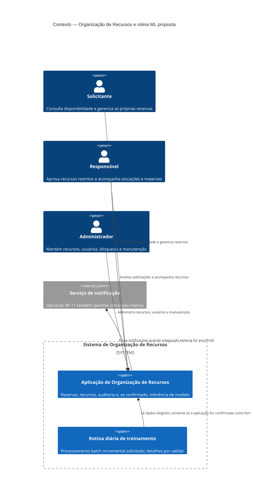
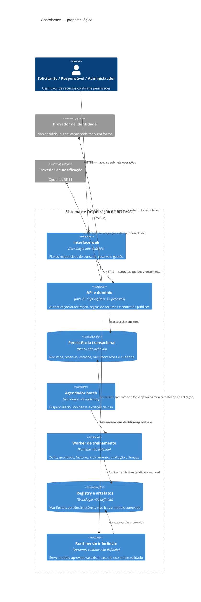
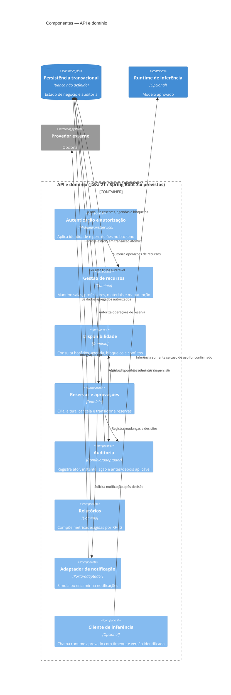
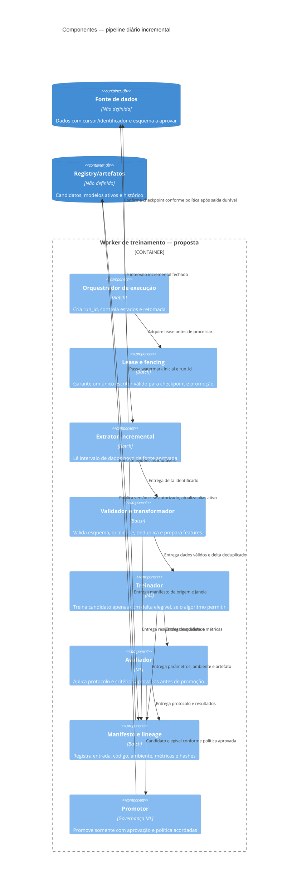
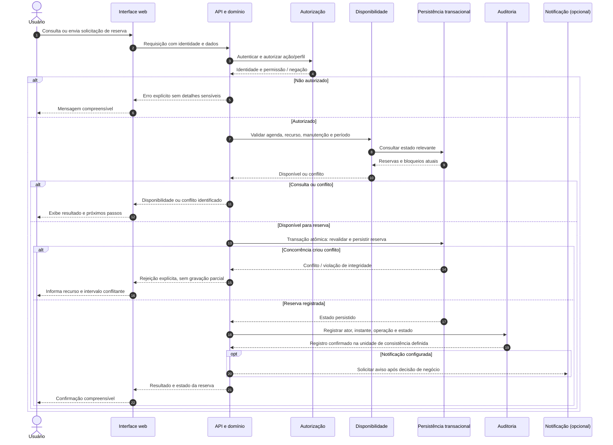

# Arquitetura — baseline inicial

> Esta é a seção inicial de análise arquitetural, não uma decisão de arquitetura detalhada. Requisitos e decisões são citados pelas fontes existentes; lacunas permanecem abertas. Este documento não altera os requisitos funcionais ou não funcionais.

## 1. Contexto e objetivo

O Sistema de Organização de Recursos deve apoiar a consulta, alocação e gestão de salas, professores e materiais, com reservas e prevenção de conflitos de horário. O projeto é semestral e sua avaliação inclui evidências de qualidade, segurança, rastreabilidade e desempenho. A visão geral registra Java 21 e Spring Boot 3.x como tecnologias previstas, mas informa que arquitetura, persistência, autenticação e integrações ainda dependem de definição ([visão-geral.md](visão-geral.md), “Visão do produto” e “Contexto técnico e entrega”; [requisitos-não-funcionais.md](requisitos-não-funcionais.md), §§ 2 e 4).

Esta análise organiza os fatores que condicionam a arquitetura e explicita o que ainda precisa de decisão, sem escolher tecnologias ou estratégias não aprovadas.

**Restrição explícita desta solicitação:** existe um cron job executado diariamente ao final do dia para treinar ou retreinar usando somente dados novos. Essa restrição foi fornecida pelo usuário nesta solicitação; ela não aparece nos requisitos funcionais, nos requisitos não funcionais ou na visão geral revisados. Seu domínio, dados, modelo e critérios operacionais ainda não estão definidos. Registrá-la aqui não altera o escopo funcional aprovado.

## 2. Stakeholders e personas

| Perfil / stakeholder | Responsabilidade ou interesse documentado | Origem |
|---|---|---|
| **Solicitante** | Professor ou coordenador; consulta disponibilidade, cria, altera e cancela as próprias reservas. | [personas.md](personas.md), § 1; RF-03, RF-04 |
| **Responsável** | Avalia solicitações especiais, valida alocação de docentes e acompanha retiradas e devoluções de materiais. | [personas.md](personas.md), § 2; RF-07, RF-09 |
| **Administrador** | Mantém cadastros de salas, professores, materiais e usuários, além de bloqueios e manutenções. | [personas.md](personas.md), § 3; RF-02, RF-08 |
| **Equipe do projeto** | Desenvolve o projeto em equipe e consulta documentação de fluxos e contratos. Não é um perfil funcional do sistema. | [visão-geral.md](visão-geral.md), “Contexto técnico e entrega”; RF-14 |

As permissões detalhadas, a designação do Responsável e a confirmação de que esses são todos os perfis permanecem pendentes ([personas.md](personas.md), “Pendências transversais para validação”; RF-01).

## 3. Requisitos arquiteturalmente significativos

Os identificadores ASR abaixo servem apenas para organizar esta análise; não substituem nem modificam os identificadores RF/RNF existentes.

| ID | Necessidade que condiciona a arquitetura | Origem e rastreabilidade |
|---|---|---|
| ASR-01 | Impedir sobreposição de reservas e preservar integridade sob solicitações simultâneas: no máximo uma reserva conflitante pode ser aceita. | RF-05, RF-06; regras prioritárias 1–3 de [requisitos-funcionais.md](requisitos-funcionais.md); RNF-02; “Tempo e concorrência” em [visão-geral.md](visão-geral.md). |
| ASR-02 | Autenticar usuários e aplicar autorização por perfil às operações e também às chamadas fora da interface. | RF-01; RNF-01; personas de [personas.md](personas.md). |
| ASR-03 | Não confirmar reservas de recursos restritos antes da aprovação do Responsável; bloquear recursos durante manutenção. | RF-07, RF-08; regras prioritárias 4–5 de [requisitos-funcionais.md](requisitos-funcionais.md). |
| ASR-04 | Manter histórico consultável e rastreável de operações relevantes e mudanças de estado, sem apagar reservas iniciadas. | RF-10; RNF-07; “Estados e auditoria” em [visão-geral.md](visão-geral.md). |
| ASR-05 | Produzir evidências de teste e qualidade rastreáveis: JUnit 5, testes de integração/API/end-to-end, Testcontainers, WireMock, JaCoCo, SonarCloud e CI em pull requests; medir desempenho com JMeter. | RNF-03 a RNF-06; estratégia de qualidade e metas em [visão-geral.md](visão-geral.md). |
| ASR-06 | Executar diariamente, ao final do dia, um cron job de treinamento ou retreinamento, usando somente dados novos. | Restrição explícita da solicitação atual do usuário; ausente dos artefatos de requisitos revisados. |
| ASR-07 | Oferecer notificações simuladas ou integração com API externa e documentar fluxos públicos e, quando aplicável, contratos de API. | RF-11, RF-14; RNF-09. A opção de integração ainda não foi decidida. |

## 4. Atributos de qualidade

| Atributo | Expectativa documentada | Fonte / limite conhecido |
|---|---|---|
| **Segurança e autorização** | Restringir dados e operações conforme identidade e perfil; validar entradas e não expor detalhes sensíveis em erros. | RNF-01, RF-01; permissões por perfil ainda precisam de detalhamento. |
| **Integridade e concorrência** | Evitar dupla reserva e alterações parciais em operações conflitantes. | RNF-02, RF-05, RF-06. |
| **Desempenho mensurável** | Avaliar consulta de disponibilidade e criação de reserva com JMeter; registrar duração, volume e falhas. | RNF-03. Limites de resposta, carga, dados e taxa de erro não foram aprovados. |
| **Testabilidade e evidência** | Testes automatizados nas fronteiras pertinentes, cobertura com JaCoCo, RTM para requisitos críticos e execução de CI em pull requests. | RNF-04 a RNF-06; metas registradas na visão geral: 80% de linhas, 70% de branches e 100% de requisitos críticos cobertos pela RTM. |
| **Auditabilidade** | Identificar operação, usuário responsável e momento da ação; manter histórico consultável por usuários autorizados. | RNF-07, RF-10. Retenção e permissões de consulta ainda não estão definidas. |
| **Usabilidade e responsividade** | Manter fluxos utilizáveis em desktop, tablet e mobile, com mensagens compreensíveis e feedback explícito. | RNF-08, RF-13. Navegadores suportados ainda não foram definidos. |
| **Documentação** | Manter documentação dos fluxos públicos e contratos coerente com o comportamento implementado. | RNF-09, RF-14. |

## 5. Drivers arquiteturais priorizados

Prioridade abaixo é uma organização inicial para orientar decisões; não é uma nova priorização de negócio nem altera o status dos requisitos.

| Prioridade | Driver | Origem |
|---|---|---|
| **P1 — obrigatório** | Integridade de reservas sob conflito e concorrência. | RF-05, RF-06; regras prioritárias 1–3 de [requisitos-funcionais.md](requisitos-funcionais.md); RNF-02; regras críticas da [visão-geral.md](visão-geral.md). |
| **P1 — obrigatório** | Rotina diária de treinamento/retreinamento ao final do dia, limitada a dados novos. | Solicitação explícita do usuário nesta tarefa; não consta do baseline dos RF/RNF. |
| **P1 — obrigatório** | Autenticação, autorização por perfil e proteção de dados/operações. | RF-01; RNF-01; personas de [personas.md](personas.md). |
| **P1 — obrigatório** | Auditabilidade de reservas, recursos, decisões e movimentações de materiais. | RF-09, RF-10; RNF-07; regras de estados e auditoria da [visão-geral.md](visão-geral.md). |
| **P2 — evidência exigida** | Verificabilidade por testes, cobertura, rastreabilidade e CI. | RNF-04 a RNF-06; estratégia e metas da [visão-geral.md](visão-geral.md). |
| **P2 — mensuração exigida; limites pendentes** | Medir desempenho nos fluxos de disponibilidade e reserva. | RF-03, RF-04, RF-06; RNF-03; JMeter previsto na [visão-geral.md](visão-geral.md). |
| **P3 — comportamento exigido** | Fluxos responsivos e mensagens claras para os três perfis. | RF-13; RNF-08; necessidades em [personas.md](personas.md). |
| **P3 — decisão de integração pendente** | Notificar usuários e documentar fluxos/contratos públicos. | RF-11, RF-14; RNF-09. |

## 6. Glossário

| Termo | Significado no contexto documentado |
|---|---|
| **Recurso** | Sala, professor, material ou equipamento gerenciado ou alocado pelo sistema. |
| **Reserva** | Solicitação para alocar recursos em um período; pode ter estados e aprovação conforme as regras aplicáveis. |
| **Recurso restrito** | Recurso ou combinação de uso que exige aprovação do Responsável antes da confirmação (RF-07); os critérios para classificá-lo ainda não foram definidos. |
| **Conflito / sobreposição** | Interseção de horários de reservas ou indisponibilidades de um mesmo recurso, incluindo a agenda do professor (RF-05). |
| **RTM** | Matriz de rastreabilidade de requisitos, usada para relacionar requisitos críticos às evidências de teste (RNF-05). |
| **Cron job** | Tarefa agendada referida na solicitação atual para executar diariamente ao final do dia o treinamento/retreinamento usando somente dados novos. |
| **Dados novos** | Dados que a rotina diária pode usar conforme a restrição explícita do usuário. Critério de novidade, origem, janela e tratamento de repetição ainda não definidos. |

## 7. Riscos iniciais

| ID | Risco | Evidência / origem |
|---|---|---|
| R-01 | A rotina de treinamento/retreinamento pode estar fora do escopo atual de organização de recursos; não há RF/RNF que descreva domínio de modelo ou dados de treinamento. | Comparação da restrição da solicitação atual com o escopo de [visão-geral.md](visão-geral.md), RF-01 a RF-14 e RNF-01 a RNF-09. |
| R-02 | “Final do dia” e “somente dados novos” não definem fuso horário, corte temporal, fonte, deduplicação, falhas ou recuperação; implementações diferentes podem violar a restrição. | Solicitação atual do usuário; sem especificação operacional correspondente nos artefatos consultados. |
| R-03 | Sem estratégia arquitetural já decidida para concorrência, a aplicação pode aceitar reservas conflitantes ou deixar gravações parciais. | RF-05, RF-06; RNF-02; estratégia ainda pendente em RF, § 6. |
| R-04 | Ausência de limites quantitativos de desempenho impede um aceite objetivo de latência, carga ou taxa de erro. | RNF-03, seção “Parâmetros pendentes de aprovação”. |
| R-05 | Perfis, retenção de auditoria, política para reservas existentes diante de manutenção e comportamento da notificação ainda não estão definidos, afetando autorização, dados e contratos. | RF, § 6; RNF, § 5; pendências em [personas.md](personas.md). |

## 8. Fatos, lacunas, conflitos e suposições

### Fatos documentados

- O sistema organiza salas, professores e materiais e deve evitar conflitos de horário (visão geral; RF-05 e RF-06).
- Os perfis documentados são Solicitante, Responsável e Administrador ([personas.md](personas.md), §§ 1–3).
- Java 21 e Spring Boot 3.x são a stack **prevista**, não uma decisão detalhada de componentes ([visão-geral.md](visão-geral.md), “Contexto técnico e entrega”; RNF, § 4).
- Testes, ferramentas e metas de qualidade estão especificados nos RNF e na visão geral; metas de desempenho quantitativo não estão fixadas (RNF-03 a RNF-06).
- A rotina diária de treinamento usando somente dados novos é uma restrição expressa pelo usuário nesta solicitação, não um requisito existente nos arquivos de requisitos.

### Lacunas

- Banco de dados, persistência, autenticação concreta, arquitetura de implantação e contratos de integração não foram decididos (visão geral; RNF, § 4).
- Os limites de desempenho e as políticas de disponibilidade, recuperação, retenção e compatibilidade de navegadores permanecem pendentes (RNF, § 5).
- Os critérios de negócio e as permissões ainda não estão completos (RF, § 6; [personas.md](personas.md), “Pendências transversais para validação”).
- Para a rotina agendada, não estão especificados dados, modelo, critério de novidade, fuso/horário exato ou comportamento em falhas (solicitação atual).

### Conflitos e ambiguidades identificados

- **Não foi encontrado conflito textual inequívoco** entre os RF e RNF consultados. Há, porém, pontos que exigem conciliação antes de decisões arquiteturais:
  - A visão geral apresenta `SOLICITADA → APROVADA → EM_USO → CONCLUÍDA`, enquanto RF-07 condiciona aprovação a recursos restritos. Não está explícito como reservas sem restrição percorrem os estados.
  - RF-05 deixa a rejeição ou revisão de conflitos conforme regra a definir; RF-06 exige que, em concorrência conflitante, apenas uma operação seja aceita. A política para encaminhamento à revisão não está especificada.
  - O treinamento/retreinamento diário foi solicitado agora, mas o escopo documental existente é a organização de recursos. A relação da rotina com o produto precisa ser confirmada; a restrição é registrada sem presumir integração ou funcionalidade adicional.

### Suposições

- Nenhuma suposição de tecnologia, volume, disponibilidade, SLA, fonte de dados ou comportamento de negócio foi adotada.
- Java 21 e Spring Boot 3.x são tratados somente como tecnologias previstas nos documentos, não como decisões adicionais desta análise.
- A restrição do cron job é tratada como obrigatória porque foi explicitamente imposta pelo usuário; detalhes não fornecidos permanecem em aberto.

## 9. Perguntas abertas

1. A rotina de treinamento/retreinamento pertence ao escopo deste sistema? Qual dado/modelo será treinado e qual origem define “dados novos”?
2. Qual horário e fuso representam “ao final do dia”? O que fazer se a rotina falhar ou encontrar dados já processados?
3. Como o fluxo de estados se aplica a reservas que não exigem aprovação?
4. Em que casos um conflito deve ser rejeitado imediatamente ou encaminhado para revisão, sem permitir duas reservas válidas?
5. Quais perfis e permissões finais se aplicam, inclusive à consulta de auditoria?
6. Quais limites quantitativos de desempenho, carga e taxa de erro serão aprovados?
7. São necessários requisitos de disponibilidade, backup e recuperação? Se sim, quais metas?
8. Qual política de retenção e acesso será aplicada ao histórico auditável?
9. Qual mecanismo de notificação será usado: simulação no sistema ou integração externa?
10. Qual banco de dados, mecanismo de autenticação e arquitetura de implantação serão escolhidos?

## Referências consultadas

- [personas.md](personas.md)
- [requisitos-funcionais.md](requisitos-funcionais.md)
- [requisitos-não-funcionais.md](requisitos-não-funcionais.md)
- [visão-geral.md](visão-geral.md)

## 10. Avaliação ATAM independente

> Análise acrescentada em 2026-11-02. Preserva as evidências anteriores e não
> altera os RF/RNF. A avaliação é independente e baseada nos documentos
> consultados; não equivale a validação por execução ou prova da arquitetura.
> Não existem arquitetura detalhada, dados de produção ou medições para validar
> comportamentos. Todo limiar quantitativo que não conste dos requisitos é
> **hipótese pendente de aprovação**, não meta aceita.

### 10.1 Drivers, atributos prioritários e abordagens consideradas

| Driver | Atributos prioritários | Abordagem arquitetural a avaliar | Evidência / limite |
|---|---|---|---|
| Evitar conflito e dupla reserva em operação simultânea | Integridade, consistência, feedback | Validar e persistir em unidade atômica; arbitrar conflito no limite de persistência e retornar rejeição explícita. Estratégia física (constraint, lock ou serialização) depende do banco ainda não escolhido. | RF-05, RF-06, RNF-02; não há banco escolhido. |
| Executar o treinamento diário somente com dados novos | Correção do processamento, recuperabilidade, rastreabilidade | Watermark/cursor persistido, janela fechada por run, manifesto e checkpoint; definir formalmente “novo” antes de implementar. | ASR-06 é solicitação explícita, ausente de RF/RNF. |
| Operar o job sem duplicidade ou sobreposição prejudicial | Consistência, disponibilidade do pipeline, recuperabilidade | Idempotência por run/janela e exclusão mútua com fencing; escolha de scheduler/lease não definida. | Lacuna operacional de ASR-06; sem requisito para mecanismo específico. |
| Impedir promoção de candidato inadequado | Qualidade do modelo, segurança operacional, auditabilidade | Treinar candidato separado do ativo, avaliar conforme critérios aprovados, promover como passo controlado e permitir retornar à versão anterior. | Não há métricas preditivas, processo de aprovação ou RF/RNF de ML. |
| Proteger dados e operações por perfil | Segurança, privacidade, auditabilidade | Autorizar no backend e nos acessos do batch/registry; minimizar dados e auditar operações privilegiadas. | RF-01, RF-10; RNF-01, RNF-07; política LGPD e retenção pendentes. |
| Medir desempenho, qualidade e conformidade | Testabilidade, observabilidade, desempenho | Usar evidências automatizadas e medições (incluindo JMeter para os fluxos previstos), sem declarar conformidade antes de aprovar cargas e limites. | RNF-03 a RNF-06; metas de cobertura existentes não são metas de latência. |

### 10.2 Utility tree

Prioridade usa **Importância** e **Dificuldade** qualitativas: Alta / Média / Baixa.
Importância deriva de requisito explícito ou do impacto operacional do cron
solicitado. Dificuldade estima incerteza e interação de decisões ainda abertas,
não esforço de implementação. Folhas e métricas sem critério aprovado indicam
medidas a coletar e pontos que precisam de decisão, não SLAs.

| Ramo de qualidade | Folha / cenário | Importância | Dificuldade | Justificativa |
|---|---|---:|---:|---|
| Integridade | AT-01: duas reservas conflitantes simultâneas | Alta | Alta | RF-06/RNF-02 exigem garantia de exclusão; estratégia de persistência está aberta. |
| Correção / dados | AT-02: execução diária no horário e período aprovados | Alta | Média | ASR-06 torna a execução diária obrigatória, mas horário, fuso e recuperação estão abertos. |
| Correção / dados | AT-03: processar exclusivamente dados novos | Alta | Alta | Restrição explícita; definição de novidade e cursor não existem. |
| Recuperabilidade | AT-04: falha parcial e retomada sem perda ou duplicidade | Alta | Alta | Necessária para cumprir execução incremental; sem política aprovada de checkpoint/retry. |
| Concorrência / disponibilidade | AT-05: execuções sobrepostas ou worker com lease vencida | Alta | Alta | Risco de checkpoint e promoção concorrentes; mecanismo de exclusão não decidido. |
| Qualidade dos dados | AT-06: dados degradados ou mudança de esquema | Alta | Alta | Sem limites de qualidade nem comportamento aprovado de quarentena/bloqueio. |
| Qualidade do modelo | AT-07: candidato pior que versão ativa | Alta | Alta | Sem métricas, baseline, avaliação ou regra de promoção definidos. |
| Recuperabilidade / auditabilidade | AT-08: rollback de modelo promovido | Alta | Média | Proposta de segurança operacional; rollback não aparece como RF/RNF. |
| Disponibilidade | AT-09: fonte, storage, registry ou runtime indisponível | Alta | Alta | Deve-se evitar corrupção e promoção parcial; disponibilidade/SLA e fallback não definidos. |
| Segurança / privacidade | AT-10: vazamento ou acesso indevido a dados/artefatos | Alta | Alta | RNF-01 e RF-01 exigem proteção; escopo de dados e controles LGPD não definidos. |
| Desempenho | AT-11: consulta e criação de reserva sob carga | Média | Alta | Medição JMeter é requerida (RNF-03), mas carga e limites permanecem pendentes. |
| Auditabilidade | AT-12: reconstruir origem e decisão de um run/modelo | Alta | Média | Rastreabilidade de negócio é exigida; lineage de ML é proposta, sem contrato aprovado. |
| Evolução / usabilidade | AT-13: mensagens claras e uso responsivo | Média | Média | RF-13/RNF-08; critérios de compatibilidade e medida de usabilidade não existem. |

### 10.3 Cenários de qualidade

Formato: **fonte, estímulo, ambiente, artefato, resposta e métrica**. Métricas
descrevem observáveis. Quando um limiar não consta dos requisitos, a coluna o
marca como pendente; nenhum valor é presumido.

#### AT-01 — Reserva concorrente (Importância alta; Dificuldade alta)

- **Fonte:** dois ou mais solicitantes autenticados.
- **Estímulo:** submetem reservas incompatíveis para o mesmo recurso e período
  com sobreposição temporal.
- **Ambiente:** fluxo online normal, com requisições concorrentes.
- **Artefato:** API de reservas, validação de disponibilidade e persistência.
- **Resposta:** no máximo uma reserva conflitante é aceita; as demais recebem
  rejeição explícita e não deixam gravações parciais.
- **Métrica:** número de reservas conflitantes aceitas por conjunto de
  requisições simultâneas (critério requerido: no máximo uma); número de
  operações rejeitadas com estado parcial (critério requerido: zero); latência
  e carga são coletadas, mas limites dependem de aprovação.
- **Rastreabilidade:** RF-05, RF-06, RNF-02; ASR-01.

#### AT-02 — Disparo diário (Importância alta; Dificuldade média)

- **Fonte:** scheduler configurado.
- **Estímulo:** chega o horário diário de treinamento/retreinamento.
- **Ambiente:** operação normal no fuso e janela lógica que ainda serão
  aprovados.
- **Artefato:** scheduler, orquestrador e registro de execução.
- **Resposta:** iniciar ou registrar a execução esperada com run identificável;
  não iniciar execução duplicada para a mesma janela; registrar resultado e
  permitir detectar execução ausente ou atrasada.
- **Métrica:** execuções iniciadas/concluídas por janela lógica; diferença entre
  horário aprovado e início/conclusão; duplicatas por janela. Horário, tolerância
  de atraso e taxa aceitável são **pendentes**, não valores definidos.
- **Rastreabilidade:** solicitação explícita do cron diário; ASR-06.

#### AT-03 — Somente dados novos (Importância alta; Dificuldade alta)

- **Fonte:** fonte de dados que vier a ser aprovada.
- **Estímulo:** job diário consulta dados elegíveis para treino.
- **Ambiente:** execução normal com watermark/checkpoint persistido e registros
  dentro e fora da janela.
- **Artefato:** extrator, filtro de elegibilidade, manifesto e checkpoint.
- **Resposta:** processar somente a janela aprovada, excluir registros já
  consumidos segundo a definição aprovada e preservar evidência reproduzível da
  seleção; não avançar cursor de modo que registros elegíveis sejam perdidos.
- **Métrica:** IDs/registros processados fora da janela ou repetidos; registros
  elegíveis omitidos; correspondência entre cursor e manifesto. Critério esperado
  para fora da janela/duplicidade: zero conforme definição de novidade; a
  semântica da janela e tratamento de late-arriving data estão pendentes.
- **Rastreabilidade:** ASR-06; definição de “dados novos” em aberto.

#### AT-04 — Falha parcial e retomada (Importância alta; Dificuldade alta)

- **Fonte:** falha de processo, rede ou armazenamento em uma fase do job.
- **Estímulo:** a execução falha após leitura, transformação, treino ou publicação
  de candidato, mas antes de confirmar todas as fases.
- **Ambiente:** execução batch com checkpoint anterior válido e possibilidade de
  retry ou retomada.
- **Artefato:** worker, estado do run, manifesto, artefatos temporários e
  checkpoint.
- **Resposta:** não promover candidato incompleto nem confirmar checkpoint sem
  saída recuperável; retomar com mesma entrada lógica ou refazer a fase de modo
  idempotente; conservar o modelo ativo.
- **Métrica:** registros perdidos/duplicados após recuperação; runs sem estado
  terminal; checkpoint avançado além da saída durável; versão ativa alterada
  durante falha. Critério desejado para perda, duplicidade e promoção inválida:
  zero; tempo máximo de recuperação e número de retries estão pendentes.
- **Rastreabilidade:** ASR-06; estratégia de checkpoint/retry é proposta, não RF.

#### AT-05 — Jobs sobrepostos (Importância alta; Dificuldade alta)

- **Fonte:** scheduler duplicado, retry, atraso de execução ou worker antigo.
- **Estímulo:** uma segunda execução reivindica a mesma janela enquanto a primeira
  ainda está ativa, ou um worker continua após expiração de seu lock.
- **Ambiente:** implantação com uma ou mais instâncias e possibilidade de
  atraso/reinício.
- **Artefato:** scheduler, lease/lock, fencing token, checkpoint e registry.
- **Resposta:** somente o proprietário válido da lease pode confirmar checkpoint
  ou promover versão; a execução concorrente é recusada, anexada ao run existente
  ou coalescida conforme política aprovada.
- **Métrica:** escritores válidos por janela, atualizações de checkpoint por
  token expirado e promoções concorrentes; critérios de integridade: um escritor
  válido e zero commit/promoção de token obsoleto. Política de coalescência e
  duração de lease estão pendentes.
- **Rastreabilidade:** ASR-06; não há mecanismo de lock escolhido.

#### AT-06 — Dados degradados (Importância alta; Dificuldade alta)

- **Fonte:** sistema produtor, alteração de esquema ou processo de ingestão.
- **Estímulo:** chegam dados ausentes, duplicados, fora de domínio, com drift ou
  incompatíveis com o esquema esperado.
- **Ambiente:** execução batch antes do treino.
- **Artefato:** validação de esquema/qualidade, quarentena, treinador e
  checkpoint.
- **Resposta:** classificar e reportar a falha; bloquear treino quando condição
  aprovada for impeditiva; não descartar silenciosamente; preservar dados
  inválidos e checkpoint conforme política de recuperação.
- **Métrica:** contagens e proporções por regra de qualidade, esquema divergente,
  registros em quarentena, runs bloqueados e dados inválidos usados em treino.
  Limites para bloqueio/aviso e tolerância são pendentes de aprovação.
- **Rastreabilidade:** ASR-06; não há requisito de qualidade de dados de ML.

#### AT-07 — Candidato pior (Importância alta; Dificuldade alta)

- **Fonte:** pipeline de treinamento/avaliação.
- **Estímulo:** candidato treinado no delta é inferior ao modelo ativo ou não
  satisfaz uma métrica de aceitação.
- **Ambiente:** avaliação offline com protocolo e baseline que precisam ser
  aprovados.
- **Artefato:** avaliador, registry, alias/versão ativa e processo de promoção.
- **Resposta:** marcar candidato como não elegível/rejeitado; não alterar modelo
  ativo; guardar evidências e motivo para auditoria.
- **Métrica:** resultado de cada critério aprovado, decisão de elegibilidade,
  alterações do alias e diferenças em relação à versão ativa. Métricas,
  baseline, tolerâncias e critérios de aceite **não estão definidos**.
- **Rastreabilidade:** ASR-06; validação/promoção de ML são lacunas.

#### AT-08 — Rollback (Importância alta; Dificuldade média)

- **Fonte:** operador autorizado ou procedimento aprovado.
- **Estímulo:** modelo promovido apresenta regressão, incompatibilidade ou falha
  operacional.
- **Ambiente:** runtime de inferência em uso, se confirmado; versão anterior
  aprovada ainda retida e compatível.
- **Artefato:** registry, alias ativo, runtime e trilha de auditoria.
- **Resposta:** restaurar referência a versão anterior aprovada, registrar ator,
  motivo e versões antes/depois; não alterar reservas nem apagar lineage.
- **Métrica:** versão ativa antes/depois, sucesso/falha da operação, tempo entre
  autorização e restauração, erros de compatibilidade e presença do registro
  auditável. Tempo-alvo e retenção mínima estão pendentes.
- **Rastreabilidade:** proposta de governança decorrente de ASR-06; rollback não
  é requisito atual.

#### AT-09 — Indisponibilidade de dependência (Importância alta; Dificuldade alta)

- **Fonte:** falha de fonte de dados, armazenamento de artefato, registry ou
  runtime de inferência.
- **Estímulo:** componente deixa de responder durante extração, publicação,
  promoção ou inferência.
- **Ambiente:** execução diária ou serviço online, conforme o componente afetado.
- **Artefato:** worker/API, checkpoint, registry, referência de modelo ativo e
  tratamento de erro.
- **Resposta:** não avançar checkpoint sem dados duráveis; não apontar produção a
  artefato incompleto; manter última versão aprovada; retornar erro explícito ou
  aplicar fallback somente se previamente aprovado. Não presumir fallback que
  possa contornar regras obrigatórias de reserva.
- **Métrica:** fase, erros, duração da indisponibilidade, checkpoint, versão
  ativa, disponibilidade observada e estado do run. SLA, RTO/RPO e política de
  fallback são pendentes.
- **Rastreabilidade:** ASR-01 e ASR-06; RNF-02; requisitos de disponibilidade/
  recuperação ainda não definidos.

#### AT-10 — Vazamento ou acesso indevido (Importância alta; Dificuldade alta)

- **Fonte:** usuário não autorizado, credencial comprometida, log/manifesto
  excessivamente detalhado ou exportação indevida.
- **Estímulo:** tentativa de consultar, alterar, copiar ou inferir dados/artefatos
  fora da permissão concedida.
- **Ambiente:** API online, worker, storage, registry, logs e backups.
- **Artefato:** autenticação/autorização, segredos, controles de acesso, logs,
  dataset/artefato e auditoria.
- **Resposta:** negar e registrar tentativa; limitar exposição; não incluir
  valores pessoais brutos desnecessários em logs/lineage; acionar procedimento
  de incidente que vier a ser aprovado.
- **Métrica:** acessos negados/permitidos por perfil, operações privilegiadas
  sem autorização, campos pessoais expostos em saída/log e cobertura de revisão
  de acesso. Critério de acesso não autorizado bem-sucedido: zero; retenção,
  classificação de dados, base legal e tempos de resposta a incidente estão
  pendentes.
- **Rastreabilidade:** RF-01, RF-10; RNF-01, RNF-07; aspectos legais e operacionais
  ainda não avaliados.

#### AT-11 — Desempenho online (Importância média; Dificuldade alta)

- **Fonte:** Solicitante consulta disponibilidade ou envia reserva.
- **Estímulo:** execução do fluxo sob carga concorrente representativa.
- **Ambiente:** perfil de carga e volume de dados a serem definidos para JMeter.
- **Artefato:** UI/API, disponibilidade, persistência e mecanismo de concorrência.
- **Resposta:** fornecer resultados corretos, sem aceitar conflito, e registrar
  latência, volume e falhas observadas.
- **Métrica:** duração por requisição, taxa de falha e volume/carga do teste,
  conforme RNF-03. Valores de carga, latência e taxa de erro são parâmetros
  pendentes; não há limite inferido nesta análise.
- **Rastreabilidade:** RF-03, RF-04, RF-06; RNF-03.

#### AT-12 — Linhagem de execução (Importância alta; Dificuldade média)

- **Fonte:** Responsável operacional ou auditor autorizado.
- **Estímulo:** precisa explicar ou reproduzir um candidato, uma promoção ou uma
  falha de execução.
- **Ambiente:** após execução concluída, rejeitada ou interrompida.
- **Artefato:** `run_id`, checkpoint, manifesto, versão de código/configuração,
  avaliação, hash e histórico do registry.
- **Resposta:** localizar janela/dados de entrada, pipeline e versões,
  resultado/decisão e ator sem expor PII desnecessária.
- **Métrica:** campos de lineage ausentes, artefatos cujo hash não corresponde,
  runs não correlacionáveis e capacidade de reconstruir a entrada lógica. Campos
  obrigatórios e retenção são decisões pendentes.
- **Rastreabilidade:** RNF-07/RF-10 para auditoria de negócio; lineage de ML é
  proposta em ASR-06.

#### AT-13 — Responsividade e comunicação (Importância média; Dificuldade média)

- **Fonte:** Solicitante, Responsável ou Administrador usando desktop, tablet ou
  dispositivo móvel.
- **Estímulo:** consulta, reserva, conflito, bloqueio ou rejeição.
- **Ambiente:** formatos de tela previstos; navegadores ainda não definidos.
- **Artefato:** interface e contrato de erro da API.
- **Resposta:** apresentar estado e ação seguinte em linguagem compreensível e
  manter o fluxo utilizável.
- **Métrica:** cenários de fluxo aprovados por dispositivo, mensagens sem
  explicação útil, erros de usabilidade observados e navegadores testados.
  Critérios de aceite e navegadores suportados devem ser aprovados; não se
  inventam percentuais de sucesso.
- **Rastreabilidade:** RF-13; RNF-08; personas.

### 10.4 Pontos de sensibilidade

Um ponto de sensibilidade é uma decisão/parâmetro cujo valor pode afetar
significativamente um atributo ou cenário.

| Ponto | Efeito e cenários | Decisão/valor ainda pendente |
|---|---|---|
| Semântica de “dados novos” e cursor | Define inclusão/exclusão, perda por eventos tardios e repetição (AT-03, AT-04). | Criados vs. alterados vs. eventos inéditos; cursor estável; janela e lateness. |
| Momento de confirmação do checkpoint | Define custo de repetição e possibilidade de perda ao falhar entre fases (AT-04, AT-09). | Após snapshot durável, treino, avaliação ou publicação; precisa de semântica explícita de recuperação. |
| Exclusão mútua/lease/fencing | Define possibilidade de dois escritores ou promoção obsoleta (AT-05). | Tecnologia, validade, heartbeat, retomada e política de coalescência. |
| Regra de conflito transacional | Determina se concorrência pode produzir dupla reserva (AT-01). | Banco e mecanismo de integridade; deve satisfazer RF-06/RNF-02 independentemente da tecnologia. |
| Regras de qualidade de dados | Afetam bloqueio, quantidade de dados de treino e disponibilidade de execução (AT-06). | Campos, limites, severidade e política de quarentena. |
| Algoritmo, avaliação e gate | Determinam se treino apenas no delta é válido e quando não promover (AT-03, AT-07). | Métricas, baseline, holdout/protocolo e autoridade. |
| Alias/versão ativa e compatibilidade | Determina risco de promoção e tempo/viabilidade de rollback (AT-07, AT-08, AT-09). | Atomicidade de troca, retenção e compatibilidade de feature/runtime. |
| Escopo de dados e autorização | Determina impacto de vazamento e possibilidade de cumprir finalidade/retensão (AT-10, AT-12). | Inventário, base legal, minimização, acesso e prazos com responsáveis competentes. |
| Carga e limites de recursos | Afeta latência online, duração do batch e competição entre API e worker (AT-02, AT-11). | Perfil JMeter, volumes, recursos de execução e limites de custo. |
| Fuso, horário e catch-up | Define atraso operacional e duplicidade lógica do cron (AT-02, AT-05). | Timezone, horário, atraso tolerável e tratamento de execução perdida. |

### 10.5 Trade-offs

| Trade-off | Benefício de uma opção | Custo/risco da opção | Cenários relacionados |
|---|---|---|---|
| Treinar apenas no delta vs. retreino cumulativo | Delta respeita literalmente a restrição e pode reduzir trabalho por run. | Algoritmo pode não aprender de forma equivalente; avaliação pode ficar enviesada ou insuficiente. Retreino cumulativo pode violar a restrição como interpretada. | AT-03, AT-06, AT-07. |
| Checkpoint somente após treino vs. snapshot durável | Após treino é simples de entender e evita marcar entrada como consumida sem modelo. | Pode obrigar releitura/reprocessamento caro após falha tardia. Snapshot durável permite retomar, mas exige storage e retenção. | AT-03, AT-04, AT-12. |
| Lock/lease distribuído vs. scheduler singleton | Lease/fencing tolera múltiplas instâncias e reduz split-brain se bem implementado. | Acrescenta estado, expiração e complexidade operacional. Singleton simplifica, mas depende da garantia do scheduler/plataforma. | AT-04, AT-05, AT-09. |
| Gate estrito de qualidade vs. continuidade do batch | Bloqueio protege contra treinar com dados degradados. | A execução pode ficar parada até correção; tolerância permissiva pode degradar o modelo. | AT-02, AT-06, AT-07. |
| Aprovação manual vs. promoção automática | Aprovação manual reduz mudança não revisada enquanto não há métricas e ownership. | Aumenta latência e dependência operacional; automação reduz intervenção, mas amplia impacto de critérios incorretos. | AT-07, AT-08, AT-12. |
| Worker isolado vs. compartilhamento de recursos com API | Isolamento limita interferência na experiência online. | Processo/ambiente dedicado pode aumentar custo/complexidade; compartilhar pode causar contenção. | AT-02, AT-09, AT-11. |
| Lineage detalhado vs. minimização/retensão de dados | Mais detalhe facilita reprodução e auditoria. | Pode replicar PII e ampliar superfície/custo de armazenamento. | AT-10, AT-12. |
| Rollback rápido via alias vs. ativação controlada | Alias pode acelerar restauração. | Sem compatibilidade validada, modelo antigo pode não funcionar com features/runtime atuais. | AT-08, AT-09. |
| Retry agressivo vs. limites/backoff | Retry aumenta chance de recuperação transitória. | Pode sobrecarregar dependências, prolongar concorrência ou criar custos; limites ainda não definidos. | AT-04, AT-05, AT-09. |

### 10.6 Riscos, não-riscos e temas de risco

**Riscos identificados**

| ID | Risco | Cenários / pontos associados | Evidência ou decisão necessária |
|---|---|---|---|
| AT-R1 | “Somente dados novos” não tem semântica operacional; implementação pode repetir ou omitir dados. | AT-03, AT-04; cursor e checkpoint. | Definir fonte, identificador, cursor, atualizações, deleções e lateness antes do aceite. |
| AT-R2 | Jobs concorrentes ou worker obsoleto podem avançar checkpoint ou promover candidato fora de ordem. | AT-05; lease/fencing. | Escolher mecanismo de exclusão e testar corrida/expiração/falha. |
| AT-R3 | Falha entre persistência de entrada, treino, publicação e checkpoint pode levar a perda, duplicidade ou estado ambíguo. | AT-04, AT-09. | Definir fronteiras duráveis, idempotência e recuperação por fase. |
| AT-R4 | Treino exclusivamente no delta pode não produzir candidato válido para algoritmo/caso de uso ainda desconhecido. | AT-03, AT-07; trade-off delta/cumulativo. | Confirmar caso de uso, algoritmo, avaliação e compatibilidade com restrição. |
| AT-R5 | Sem baseline, métrica e limiar aprovados, candidato inferior pode ser promovido ou candidato aceitável bloqueado. | AT-07, AT-08. | Acordar critérios, autoridade, política de promoção e rollback. |
| AT-R6 | Dados degradados ou mudança de esquema podem contaminar treino ou interromper indefinidamente o cron. | AT-06, AT-02. | Definir validações, níveis de severidade, quarentena e recuperação. |
| AT-R7 | Acesso excessivo a dados, logs, snapshots ou registry pode expor dados pessoais/sensíveis. | AT-10, AT-12; lineage vs. minimização. | Inventariar dados, avaliar finalidade/base legal, acesso, retenção e descarte. |
| AT-R8 | Indisponibilidade sem política de fallback pode tornar o serviço ou o treino indisponível ou produzir sucesso falso. | AT-09, AT-02, AT-11. | Definir SLAs/RTO/RPO, comportamento de degradação e comunicação de falhas. |
| AT-R9 | Competição de CPU/memória entre treino e API pode degradar consulta/reserva. | AT-11, AT-02; worker compartilhado/isolado. | Medir carga representativa e decidir isolamento/limites. |
| AT-R10 | Requisitos de auditoria de negócio e retenção podem conflitar com exclusão/minimização de dados de ML. | AT-10, AT-12. | Definir quais dados de auditoria precisam persistir e separar payload pessoal de metadados. |

**Não-riscos (com evidência disponível)**

| ID | Item analisado | Por que não é risco arquitetural confirmado neste momento | Condição para reclassificar |
|---|---|---|---|
| AT-NR1 | Escolha de banco/serviço de cloud como falha atual | Nenhuma tecnologia foi escolhida; não há decisão ou implementação a falhar. | Após selecionar tecnologia, avaliar semântica de concorrência, operação, segurança e custo. |
| AT-NR2 | Inferência ML online no caminho de reserva | Não há requisito nem caso de uso confirmado que conecte modelo à reserva; não se presume essa integração. | Reclassificar se um requisito vier a colocar previsões no fluxo transacional. |
| AT-NR3 | Limite de latência específico não atingido | RNF-03 exige medir, mas declara que tempos/carga/taxa de erro aguardam aprovação; não há valor normativo a violar. | Aprovar perfil de carga e limiares antes de julgar conformidade. |
| AT-NR4 | Regra de negócio de aprovação de ML atribuída ao perfil Responsável | A persona trata aprovações de reserva, não aprovação de modelo. Não é correto inferir essa autoridade. | Nomear aprovador de ML/dados ou estabelecer governança equivalente. |

“Não-risco” significa ausência de evidência para afirmar um risco arquitetural
real no baseline; não significa garantia de segurança ou qualidade futura.

**Temas de risco a acompanhar**

- **Integridade do estado e consistência temporal:** AT-R1 a AT-R3; afeta
  checkpoints, reprocessamento e concorrência de jobs.
- **Adequação estatística/semântica do treinamento:** AT-R4 a AT-R6; depende do
  domínio que ainda não foi especificado.
- **Segurança, privacidade e conformidade:** AT-R7 e AT-R10; base legal,
  categorias de dados, retenção e responsáveis precisam de avaliação competente.
- **Resiliência operacional:** AT-R2, AT-R3 e AT-R8; política de indisponibilidade
  e metas de recuperação não existem no baseline.
- **Contenção de recursos e custo:** AT-R9; volume, orçamento e topologia estão
  ausentes.
- **Governança e responsabilização:** AT-R5, AT-R7 e AT-R10; autoridade para
  aprovar, promover, auditar e responder a incidente não está definida.

### 10.7 Síntese da avaliação e questões para decisão

O baseline tem drivers fortes e testáveis para reservas concorrentes, autorização,
auditoria e medição de qualidade. Para o cron de ML, existe a restrição de
frequência e incrementalidade, mas ainda não existe informação suficiente para
afirmar que um pipeline concreto produzirá um modelo válido, seguro ou útil. A
arquitetura deve permanecer condicional até que escopo, fonte, semântica de dados
novos, algoritmo, avaliação e operação sejam aprovados.

Decisões que bloqueiam uma avaliação conclusiva:

1. Definir se o modelo integra o produto e qual decisão/usuário ele atende.
2. Especificar a fonte e o contrato de incrementalidade, incluindo atualizações,
   eventos tardios e exclusões.
3. Aprovar horário/fuso, recuperação de execução perdida e política de
   checkpoint.
4. Confirmar que treino apenas no delta é adequado ou decidir alternativa
   compatível com a restrição.
5. Aprovar métricas, baseline, critérios de bloqueio/promoção e responsável.
6. Definir dados pessoais tratados, finalidade/base legal, minimização, acesso,
   retenção e eliminação com os responsáveis competentes.
7. Fixar perfil de carga e limites quantitativos de desempenho, disponibilidade,
   recuperação e custo, se forem necessários para aceite.

## Histórico da análise ATAM

- **2026-11-02:** acrescentada avaliação independente com utility tree, cenários,
  sensibilidades, trade-offs, riscos, não-riscos e temas de risco. Valores
  quantitativos não definidos pelos requisitos foram mantidos como hipóteses
  pendentes; o conteúdo arquitetural anterior foi preservado.

---

## 11. Arquitetura — proposta complementar

> **Status: proposta para revisão; não aprovada como decisão de produto ou tecnologia.**
> Esta seção complementa o baseline arquitetural apresentado anteriormente neste
> documento. Requisitos e fatos abaixo são rastreados às fontes; as recomendações
> novas estão identificadas como propostas ou decisões sem requisito.
> Não há implementação de código nesta entrega.

### 1. Escopo, fontes e rastreabilidade

O baseline trata da aplicação de organização de salas, professores e materiais,
reservas, aprovações, manutenção e auditoria. A stack prevista é Java 21 e Spring
Boot 3.x, sem decisão documentada sobre banco, autenticação, implantação ou
integrações ([visão-geral.md](visão-geral.md), “Contexto técnico e entrega”).

O cron diário de treinamento/retreinamento usando apenas dados novos é uma
restrição explícita desta solicitação, não um RF/RNF validado. Não estão definidos
o caso de uso do modelo, sua fonte de dados, a definição de dado novo, o algoritmo,
os usuários de inferência nem critérios de promoção. A arquitetura de ML abaixo é,
portanto, uma proposta condicionada à confirmação de escopo, não uma afirmação de
que esses elementos já existem.

| Driver | Consequência arquitetural | Rastreabilidade |
|---|---|---|
| Evitar reservas conflitantes inclusive sob concorrência | Validar e persistir reserva atomicamente; impor a regra no limite transacional de persistência, não só na interface. | RF-04 a RF-06; RNF-02; regra crítica “Tempo e concorrência” em [visão-geral.md](visão-geral.md). |
| Aplicar identidade e permissões fora da interface | Autenticação e autorização no backend para cada operação protegida; auditoria de acessos negados. | RF-01; RNF-01. |
| Aprovar recursos restritos e bloquear manutenção | Manter regras de estado e disponibilidade no domínio transacional do backend. | RF-07 e RF-08. |
| Rastrear mudanças relevantes e preservar reservas iniciadas | Histórico associado às operações e mudanças de estado, com acesso autorizado. | RF-09 e RF-10; RNF-07. |
| Medir qualidade e desempenho com evidências | Interfaces testáveis, testes de integração concorrente e medição de JMeter; não implica metas de latência ainda ausentes. | RNF-03 a RNF-06; metas de cobertura da visão geral. |
| Executar treinamento diário somente com dados novos | Pipeline batch com corte incremental explícito, checkpoint, deduplicação, retomada e evidência da origem dos dados. | Restrição desta solicitação; detalhe operacional ainda sem requisito. |
| Ser responsivo e documentar os contratos públicos | UI desacoplada dos contratos de backend; documentação atualizada com os fluxos efetivamente implementados. | RF-13 e RF-14; RNF-08 e RNF-09. |

### 2. Responsabilidades e limites

#### 2.1 Domínios e componentes lógicos

| Componente | Responsabilidades | Limites / não responsabilidades |
|---|---|---|
| Interface web | Apresentar consulta, reservas, estados, conflitos e feedback responsivo aos três perfis. | Não decide autorização final, disponibilidade, aprovação ou integridade; nenhuma regra crítica depende da UI. |
| API e domínio de recursos | Expor operações públicas; aplicar autenticação/autorização; coordenar regras de recursos, agenda, reserva, manutenção e aprovação; devolver erros de negócio compreensíveis. | Não aceita duas reservas conflitantes; não executa treinamento no caminho síncrono de uma requisição. |
| Persistência transacional | Persistir recursos, reservas, estados, movimentos e registros de auditoria com atomicidade e proteção contra concorrência. | Tecnologia, esquema e estratégia física de lock ainda não escolhidos. |
| Adaptador de notificação | Registrar e encaminhar notificações de estado, conflito e pendências. | Provedor externo não é obrigatório: RF-11 também admite notificação simulada. |
| Scheduler do batch | Disparar a execução diária no horário/fuso que vier a ser aprovado, obter exclusividade e criar um identificador de execução. | Não define sozinho o conceito de “dia” nem pode avançar o checkpoint de dados sem as condições de conclusão definidas. |
| Ingestão e preparação ML | Ler somente o delta elegível, validar esquema/qualidade, deduplicar, preparar features e produzir manifesto de dados do run. | Não deve ampliar silenciosamente a janela para dados antigos; não determina ainda quais campos são necessários ou legítimos. |
| Treinador e avaliador | Treinar candidato, calcular métricas acordadas e comparar com o modelo vigente usando uma avaliação reproduzível. | Não promove um modelo sem critérios e autoridade de aprovação definidos; algoritmo e métricas dependem do caso de uso. |
| Registry e armazenamento de artefatos | Manter versões imutáveis, metadados, lineage, estado de aprovação e referência ao modelo ativo. | É uma separação lógica; produto, fornecedor e política de retenção ainda não foram escolhidos. |
| Runtime de inferência (condicional) | Servir a versão aprovada somente se for confirmado um fluxo funcional que consome previsões. | Não se presume que reserva, busca ou alocação usem ML; não substitui regras determinísticas obrigatórias de conflito e autorização. |

#### 2.2 Responsabilidades operacionais

Os perfis de produto existentes são Solicitante, Responsável e Administrador
([personas.md](personas.md)). Eles não estabelecem quem opera dados, aprova modelos
ou responde por infraestrutura. Para implantação, devem ser atribuídas
explicitamente as responsabilidades abaixo; os nomes são funções propostas, não
novas personas ou papéis aprovados:

| Função a atribuir | Responsabilidade operacional |
|---|---|
| Proprietário do produto/dados | Confirmar finalidade do modelo, dados permitidos, critérios de sucesso, retenção e autorização de uso. |
| Responsável por ML/dados | Manter pipeline, qualidade, features, avaliação, lineage e reprodutibilidade do treino. |
| Operação/plataforma | Agendamento, credenciais, capacidade, alarmes, recuperação e disponibilidade de API/worker/storage. |
| Aprovador de modelo | Autorizar promoção conforme critérios e processo que ainda precisam ser acordados. |
| Segurança/privacidade | Validar base legal, minimização, acesso, retenção, atendimento a direitos e controles LGPD junto às pessoas responsáveis. |

Separação de funções, níveis de aprovação e acesso são decisões abertas. Não se
deve conceder a todos os administradores de recursos acesso automático a dados de
treino ou ao registry.

### 3. Limites e contratos de interface

Os contratos abaixo são lógicos. RF-14 exige documentar os fluxos/contratos
públicos; formatos, endpoints, autenticação concreta e versões ainda devem ser
definidos antes da implementação.

| Interface | Consumidor → provedor | Contrato e garantias propostas | Estado |
|---|---|---|---|
| UI → API de recursos | Navegador → API | Operações de consulta, reserva, alteração, cancelamento e acompanhamento; identidade em cada chamada; erros de validação, autorização e conflito distinguíveis; documentar request/response e códigos. | Necessidade rastreada em RF-01, RF-03, RF-04, RF-13 e RF-14; protocolo/formatos em aberto. |
| API → persistência | Domínio → armazenamento transacional | Uma única unidade atômica para validar disponibilidade e persistir reserva/alteração e auditoria associada. Conflito concorrente produz rejeição explícita e sem gravação parcial. | Garantia requerida por RF-06 e RNF-02; banco e mecanismo de concorrência em aberto. |
| API → notificação | Domínio → adaptador | Evento com identificador, tipo, destinatário autorizado e referência da operação; falha de envio não deve desfazer uma reserva já confirmada. | RF-11 permite simulação ou provedor externo; consistência/retry ainda precisam de decisão. |
| Scheduler → worker batch | Scheduler → execução | `run_id`, data lógica, configuração/versionamento e watermark inicial; execução reivindicada por lock com prazo e token de fencing. | Proposta para garantir execução rastreável e sem concorrência; detalhes não exigidos além da rotina diária. |
| Worker → fonte de dados | Ingestão → fonte aprovada | Leitura incremental delimitada por cursor/watermark e manifesto; contrato de esquema, ordenação, identificador estável e semântica de atualização/remoção definidos por fonte. | Fonte, CDC/API/exportação, esquema e critério de novidade pendentes. |
| Worker → registry/artifact store | Treinador/avaliador → registry | Publicar candidato imutável com hash, manifesto de dados, versões, métricas e estado; ativação separada da publicação. | Proposta de governança sem produto/ferramenta ou política aprovada. |
| API → runtime de modelo | API → runtime (condicional) | Solicitação de inferência versionada, timeout e resposta tipada; identificar a versão usada na evidência da operação. | Interface somente se caso de uso online for confirmado; sem endpoint/modelo definido. |

Os nomes das entidades, esquemas, rotas, autenticação, formatos de evento e
políticas de retry devem ser especificados após a confirmação dos contratos. Não
se presume sincronização de identidades com provedor externo.

### 4. Diagramas C4

Os diagramas mostram limites lógicos propostos. Não fixam produtos, provedores ou
implantação. O runtime de inferência e a notificação externa são opcionais até
validação dos requisitos pendentes.

#### 4.1 Contexto



#### 4.2 Contêineres



#### 4.3 Componentes da API



#### 4.4 Componentes do pipeline batch



### 5. Sequências

#### 5.1 Fluxo online — consulta/criação de reserva

O fluxo online abaixo é o comportamento funcional já descrito. A inferência não
participa da regra de conflito e somente deve ser incluída se um caso de uso de
ML online for confirmado.



#### 5.2 Fluxo batch — execução diária incremental

O horário “final do dia”, fuso, atraso máximo e política de execução perdida
precisam de decisão. Uma execução não deve interpretar uma falha como autorização
para avançar o cursor ou incluir dados antigos sem controle.

```mermaid
sequenceDiagram
    autonumber
    participant S as Scheduler diário
    participant W as Worker
    participant L as Lease/lock e checkpoint
    participant D as Fonte de dados aprovada
    participant Q as Qualidade e preparação
    participant T as Treinador
    participant E as Avaliador
    participant R as Registry/artefatos
    actor A as Aprovador (se exigido)

    S->>W: Disparar data lógica e configuração
    W->>L: Adquirir lease e fencing token
    alt Lease já válida
        L-->>W: Execução concorrente existente
        W-->>S: Não iniciar segundo escritor; registrar execução ignorada/concorrente
    else Lease concedida
        L-->>W: Token, run_id e checkpoint confirmado C
        W->>D: Fixar limite superior H e ler somente (C, H]
        D-->>W: Delta com IDs/cursor estáveis
        W->>Q: Validar esquema, duplicatas, elegibilidade e qualidade
        alt Falha de qualidade que bloqueia treino
            Q-->>W: Falha classificada e registros/partição em quarentena
            W->>R: Persistir evidência de falha e manifesto parcial
            W->>L: Liberar lease sem avançar checkpoint de treino
        else Delta aceito
            Q-->>W: Delta validado e resultado de qualidade
            W->>T: Treinar candidato somente com delta elegível
            T-->>W: Artefato candidato e parâmetros
            W->>E: Avaliar candidato conforme protocolo aprovado
            E-->>W: Métricas, comparação e decisão de elegibilidade
            W->>R: Publicar candidato imutável, lineage e evidências
            alt Critérios não atingidos
                W->>R: Marcar candidato como rejeitado; manter versão ativa
                Note over W,L: O avanço do checkpoint depende da política de processamento aprovada, não da promoção.
            else Critérios atingidos
                opt Aprovação humana exigida
                    W->>A: Solicitar revisão de candidato e evidências
                    A-->>W: Aprovar ou rejeitar promoção
                end
                alt Aprovação concedida ou promoção automática autorizada
                    W->>R: Promover versão e atualizar referência ativa atomicamente
                else Sem aprovação
                    W->>R: Manter candidato sem alterar versão ativa
                end
            end
            W->>L: Confirmar checkpoint somente após saída durável e condição aprovada
            W->>L: Liberar lease
        end
    end
```

#### 5.3 Inferência online condicional

Se um requisito futuro aprovar uma previsão consumida em uma jornada online, o
backend pode chamar um runtime separado com timeout e fallback explicitamente
definidos. A previsão não pode violar regras obrigatórias de disponibilidade,
autorização ou concorrência. Sem requisito de fallback, não se presume resposta
de sucesso se o runtime estiver indisponível: a operação deve seguir uma política
aprovada (falhar, degradar sem ML ou tentar novamente).

### 6. Projeto do cron incremental e governança de ML

#### 6.1 Watermark e checkpoint

**Recomendação proposta:** manter o cursor de leitura da fonte separado do
checkpoint de treino e do estado do modelo ativo. Usar watermark composto
(`updated_at`, identificador estável) ou cursor monotônico/CDC se a fonte oferecer
essa garantia; fechar cada execução com um limite superior `H` e processar apenas
o intervalo após o último cursor confirmado até `H`. O par ordenado evita perder
registros com timestamps iguais. A fonte e semântica de alteração/exclusão
precisam ser escolhidas antes de implementar.

- Persistir por execução o cursor inicial/final, `run_id`, contagens, hash do
  manifesto e estado; não depender apenas do horário de início do cron.
- Não avançar cursor enquanto os dados elegíveis e manifesto duráveis não
  permitirem retomar o processamento sem perda. Definir se cursor avança após
  persistência de snapshot ou apenas após treino concluído; isso muda retentativa
  e atraso e requer decisão de produto/operação.
- Se a origem não oferecer cursor confiável, alternativas são CDC/log de eventos,
  exportação por snapshot com identificador estável, ou janela temporal com
  sobreposição e deduplicação. Janela temporal isolada não garante capturar
  atualizações tardias nem remoções.
- “Somente dados novos” precisa especificar se significa criados após o último
  run, alterados após ele, nunca usados em treino, ou eventos inéditos. Sem isso,
  o contrato de incrementalidade não é testável.

#### 6.2 Idempotência, lock e concorrência

- Criar uma chave determinística de idempotência a partir da fonte, janela/cursor,
  versão do pipeline e configuração; impor unicidade no registro de execução.
  Repetir a mesma solicitação recupera o mesmo run em vez de duplicar publicação.
- Usar lease exclusiva com expiração, heartbeat e token de fencing monotônico. Um
  worker cujo lease expirou não pode confirmar checkpoint nem promover candidato
  depois que outro worker assumiu.
- A criação da execução, atualização de checkpoint e troca do alias ativo devem
  ser atômicas em seus respectivos limites de consistência; staging deve ser
  imutável e promoção uma alteração controlada de referência.
- Alternativas para exclusividade: scheduler com execução singleton, lease em
  banco, ou lock distribuído. Escolha do mecanismo depende da implantação; evitar
  lock local de processo em ambiente com mais de uma instância.
- Definir se uma execução atrasada é ignorada, executada imediatamente ou
  coalescida com a próxima janela. Não se permite concorrência de execuções
  sobrepostas sem política explícita.

#### 6.3 Retry, recuperação e falha parcial

- Separar fases idempotentes: obter delta, materializar manifesto, validar,
  treinar, avaliar, registrar candidato, promover e confirmar checkpoint.
- Retry limitado com backoff exponencial e jitter para falhas transitórias;
  limites, timeout e alarme precisam ser acordados. Erros determinísticos de
  esquema/qualidade não devem entrar em retry infinito.
- Registrar estado de fase e artefatos temporários sob `run_id`. Após reinício,
  retomar da última fase com saída íntegra ou reiniciar a fase com mesmo input
  imutável.
- Em falha antes de publicação, manter o modelo vigente e o checkpoint anterior.
  Em falha após publicação do candidato, mas antes da promoção, conservar o
  candidato para revisão e não tratá-lo como ativo.
- Uma falha de promoção não deve deixar alias apontando a artefato incompleto.
  Uma falha de notificação/alerta também não deve refazer treinamento concluído.
- Definir política de catch-up, número máximo de tentativas, alertas, recuperação
  manual e tratamento de partições inválidas antes de operação.

#### 6.4 Qualidade dos dados e linhagem

Antes do treino, verificar esquema e versão, campos obrigatórios, tipos, valores
fora de domínio, nulos, duplicatas, cardinalidade e distribuição. Limites
específicos dependem do domínio e devem ser aprovados, não inferidos. Classificar
achados como bloqueantes ou advertências; quantificar registros elegíveis,
rejeitados e em quarentena. Não descartar linhas silenciosamente.

O manifesto de lineage por execução deve referenciar, no mínimo:

- fonte e versão de esquema, cursor inicial/final, limite `H` e IDs/checksum do
  conjunto de dados (ou referência controlada, sem copiar PII desnecessariamente);
- regras de elegibilidade, transformações/features e versão do código;
- imagem/runtime e dependências fixadas, configuração e hiperparâmetros;
- seed quando suportado, protocolo de avaliação, métricas, resultados de qualidade;
- hash do artefato, versão do modelo, run que o originou, aprovador e timestamps.

Controlar drift de esquema e de distribuição como indicadores; seus limites e a
ação decorrente (alertar, bloquear ou revisar) ainda são decisões abertas. Logs e
lineage não devem conter valores sensíveis brutos.

#### 6.5 Reprodutibilidade e validação

- Materializar ou referenciar um snapshot imutável do delta usado em cada run;
  fixar versão de código, ambiente, bibliotecas e parâmetros. Reexecução deve
  poder reconstruir a mesma entrada lógica.
- Usar seed fixa quando algoritmo/runtime oferecer determinismo; registrar
  variação não determinística e tolerâncias quando reprodução bit a bit não for
  possível.
- Separar treino (delta novo) de avaliação. Comparar candidato com modelo ativo
  e critérios aprovados; nenhuma métrica, threshold, janela de validação ou
  objetivo de negócio é presumido neste documento.
- Distinguir validação técnica (esquema, integridade, artefato carregável) de
  validação de qualidade preditiva e de aprovação de negócio.
- Verificar compatibilidade de versão/feature e comportamento seguro antes de
  disponibilizar inferência.
- A restrição “treinar usando somente dados novos” não resolve como avaliar o
  modelo. Alternativas: holdout previamente separado e autorizado; protocolo
  temporal que não use dados antigos para ajuste; ou validação externa aprovada.
  Um algoritmo não incremental pode não produzir modelo equivalente treinando
  apenas no delta. Deve-se escolher entre algoritmo incremental, retreino
  cumulativo explicitamente autorizado, ou rever a restrição; não ocultar essa
  incompatibilidade.

#### 6.6 Versionamento, registry, promoção e rollback

**Proposta:** cada candidato e versão promovida é imutável e possui ID/hash,
manifesto, métricas, versão de código e estado controlado. Estados lógicos
sugeridos: `CANDIDATE`, `VALIDATED`, `APPROVED`, `PRODUCTION`, `REJECTED`,
`ARCHIVED`. O alias de produção aponta para uma única versão aprovada; publicar
artefato não equivale a promovê-lo.

- Registrar histórico de transições, executor/aprovador e justificativa; separar
  publicação do candidato e atualização do alias ativo.
- Promoção automática só é aceitável se critérios, limiares, autoridade e
  auditoria forem explicitamente aprovados. Alternativa conservadora: aprovação
  manual até existir evidência e ownership operacional.
- Manter identificável a versão efetivamente usada por cada inferência/decisão,
  se a inferência fizer parte do produto.
- Rollback consiste em repontar o alias para a última versão aprovada compatível,
  com operação auditada e validada. Manter artefato e dependências suficientes
  para reativação; retenção ainda precisa de política.
- Rollback do modelo não reverte reservas, auditoria ou demais dados de negócio.
  Compatibilidade de features/contratos deve ser validada antes da troca.
- Canary, shadow e A/B são alternativas de rollout, não requisitos existentes.
  Só adotar após definir tráfego permitido, métricas, privacidade e critério de
  abortar; para a primeira versão, promoção explícita com rollback simples é a
  opção recomendada.

### 7. Observabilidade, segurança, LGPD e custos

#### 7.1 Observabilidade

Correlacionar requisições online com IDs de operação e execuções batch com
`run_id`; não usar dados pessoais nos identificadores ou logs. Métricas iniciais:

- **Online:** latência, taxa de erro, rejeições por conflito, falhas de
  autorização, falhas de persistência e resultados de notificação.
- **Batch:** último sucesso, atraso do watermark, tamanho do delta, duração por
  fase, tentativas, estado do lock, falhas, registros válidos/rejeitados,
  qualidade/drift, versão candidata e decisão de promoção.
- **Modelo (se aplicável):** versão ativa, erros/latência de inferência e métricas
  acordadas de qualidade; observar drift sem expor atributos sensíveis.

Logs estruturados, métricas e alertas devem permitir investigar run e mudança de
modelo. Limites de latência, atraso aceitável, disponibilidade, retenção e destino
de alarmes não estão especificados. O painel observa; não deve contornar aprovação
ou alterar o alias de produção sem autorização.

#### 7.2 Segurança e LGPD

- Aplicar menor privilégio a API, worker, fonte, registry e operador; credenciais
  distintas por componente, armazenadas em mecanismo seguro de segredos e
  rotacionáveis. Evitar credenciais em código, logs, manifests ou diagramas.
- Criptografar comunicação em trânsito e armazenamento conforme capacidade do
  ambiente escolhido; controlar acesso a snapshots, artefatos e lineage.
- Antes do treino, confirmar finalidade, base legal com responsáveis, categorias
  de dados, necessidade, minimização, retenção, compartilhamentos e procedimento
  para direitos dos titulares. Isso não constitui declaração de conformidade
  legal.
- Preferir identificadores pseudonimizados e features mínimas; separar mapa de
  reidentificação da área de treino quando necessário. Pseudonimização não é
  anonimização.
- Estabelecer retenção e eliminação para dados de entrada, snapshots, logs,
  artefatos e backups; avaliar como atender eliminação/correção sem apagar a
  auditoria obrigatória ou comprometer a integridade. Prazo e exceções dependem
  de decisão legal e de negócio.
- Restringir consultas e exportações de RF-12 ao perfil autorizado; auditar
  acesso e mudanças de permissões. Evitar que métricas agregadas reidentifiquem
  indivíduos.
- Validar entradas e autorização também em APIs, tarefas agendadas e ações de
  promoção; proteger endpoints operacionais contra invocação não autorizada.

#### 7.3 Custos e capacidade

Não há orçamento, volume de dados, provedor ou metas de custo aprovados. O custo
será controlado por processamento incremental, limites de CPU/memória/tempo por
run, concorrência unitária, encerramento do worker após o job, retenção limitada
e monitoramento de armazenamento e computação. Valores e quotas devem ser
definidos após uma estimativa com volume e algoritmo reais.

Alternativas de hospedagem: mesma plataforma da aplicação com worker separado,
serviço batch gerenciado, ou execução em infraestrutura acadêmica/local. A
primeira reduz diversidade operacional em escala pequena, mas pode competir com
API por recursos; serviço gerenciado pode reduzir operação, mas introduz custo e
dependência de fornecedor. A escolha depende de escala, orçamento e ambiente de
entrega, hoje não especificados.

### 8. Decisões propostas e alternativas

Nenhuma linha abaixo altera RF/RNF. “Sem requisito” significa que a escolha é
recomendação arquitetural para tornar a solução operável e ainda requer aceite.

| Decisão proposta | Justificativa rastreável | Alternativas / quando escolher | Status |
|---|---|---|---|
| Separar API online e worker batch, mesmo que compartilhem repositório no início. | A reserva exige baixa ambiguidade transacional e o treino tem execução diária, falha e recuperação próprias (RF-06/RNF-02; restrição do cron). | Processo único simples para protótipo de baixo volume; serviços separados se isolamento/crescimento justificar. | Sem requisito de implantação; proposta. |
| Usar persistência transacional e uma garantia de exclusão de conflito na camada de dados. | RF-06/RNF-02 exige atomicidade e ausência de race condition. | Constraint de exclusão, lock pessimista/otimista ou serialização; depende do banco e do modelo temporal escolhidos. | Garantia requerida; tecnologia e mecanismo abertos. |
| Fazer leitura incremental por cursor composto ou CDC e registrar manifestos por run. | Restrição de usar apenas dados novos; protege contra duplicação e perda com retry. | Snapshot/delta exportado com IDs estáveis; janela sobreposta apenas se deduplicação e lateness forem conhecidos. | Sem requisito técnico específico; proposta. |
| Aplicar lease com fencing, chave idempotente e confirmação controlada do cursor. | O job diário precisa ser seguro contra concorrência/reexecução e recuperar falhas sem corrupção. | Scheduler singleton ou lock transacional, conforme plataforma; lock local não serve para múltiplas instâncias. | Sem requisito operacional detalhado; proposta. |
| Manter modelo candidato separado do modelo ativo e promover por referência controlada. | Permite validar, auditar e retornar a uma versão anterior; requisito de validação/rollback não está nos RF/RNF, mas é necessário para recomendação responsável de ML. | Deploy direto do único artefato (menor complexidade, maior risco); aprovação manual ou promoção automática após política aprovada. | Sem requisito; proposta. |
| Não acoplar inferência síncrona ao fluxo de reserva até validar seu uso. | RF-05/RF-06 impõe regras determinísticas; nenhum requisito atribui decisão a modelo. | Runtime online separado caso um caso de uso preditivo seja aprovado e tenha fallback definido. | Sem requisito de ML online; recomendação. |
| Manter tecnologias de banco, scheduler, object store, registry e autenticação em aberto. | Os documentos dizem que essas escolhas estão pendentes; evita transformar uma hipótese em fato. | Selecionar após requisitos de escala, implantação, orçamento, segurança e capacidade da equipe. | Decisão pendente, não escolha. |
| Exigir ownership, aprovação e política de promoção antes de automatizar ativação do modelo. | Evita mudança automática de comportamento sem responsável ou critério rastreável; não há política nos RF/RNF. | Aprovação manual no início; automação condicionada a limites e evidência aprovados. | Sem requisito; proposta de governança. |
| Limitar observabilidade a métricas e lineage com minimização de dados pessoais. | RNF-01 e RNF-07 exigem proteção e rastreabilidade; LGPD requer avaliar finalidade e tratamento. | Dados detalhados apenas em ambiente controlado e com retenção/autorização aprovadas. | Controles de proteção exigidos em princípio; política concreta pendente. |

### 9. Suposições explícitas, alternativas e decisões necessárias

Nenhuma hipótese abaixo é tratada como fato. Recomendações condicionais devem ser
revistas quando a informação correspondente for conhecida.

| Tema não especificado | Suposição de trabalho (não fato) | Alternativa relevante / decisão necessária |
|---|---|---|
| Escopo do modelo | O job é parte do projeto e deve produzir candidato de modelo; sua finalidade não está conhecida. | Confirmar que é fora de escopo; ou descrever caso de uso, usuário, decisão apoiada e dano potencial. |
| Fonte e “dados novos” | Não se presume que reservas sejam dados de treino nem que criação seja o único critério de novidade. | Escolher fonte autorizada e semântica: novos registros, atualizações, eventos não processados ou outra regra. |
| Algoritmo | Não se presume algoritmo incremental nem suitability para treino em delta. | Selecionar algoritmo que aprende do delta, aprovar conjunto acumulado, ou revisar a restrição se delta-only for inadequado. |
| Avaliação | Não se presumem métrica, holdout, threshold ou baseline. | Definir avaliação temporal, holdout previamente separado ou avaliação externa permitida; aprovar thresholds e rejeição. |
| Inferência | Não se assume consumidor online. | Confirmar endpoint/caso de uso; ou manter treinamento e registry sem serving online. |
| Frequência e horário | Apenas frequência diária e “final do dia” vêm da solicitação; fuso e tolerância não. | Definir timezone, horário, janela lógica, catch-up e prazo máximo de conclusão. |
| Banco e implantação | Java/Spring são previstos, mas banco e topologia não. | Relacional como candidato para integridade transacional; outras tecnologias só após demonstrar semântica equivalente e atender testes de concorrência. |
| Aprovação | A persona Responsável trata reservas; não há aprovador de ML definido. | Nomear aprovador de produto/dados ou aprovar promoção automática com controles e critérios explícitos. |
| Dados pessoais | Não se sabe se os dados de treino incluem dados pessoais ou sensíveis. | Inventariar campos e finalidade; excluir, minimizar ou pseudonimizar; obter avaliação dos responsáveis legais/de privacidade. |
| Carga/custos | Não há volume, orçamento ou SLA. | Medir amostra representativa e comparar worker local, compartilhado e gerenciado; definir limites depois. |

#### Decisões necessárias antes de implementar o batch

1. Confirmar se o job pertence ao produto e descrever sua finalidade/caso de uso.
2. Indicar fonte, proprietário, campos permitidos, identificador estável e
   semântica de novos/alterados/removidos.
3. Aprovar horário, fuso, watermark inicial, lateness, política de catch-up e
   quando o checkpoint pode avançar.
4. Escolher algoritmo e esclarecer se treinar só com delta é tecnicamente válido;
   definir como validar sem quebrar a restrição de treino.
5. Definir métricas/thresholds, baseline, responsável pela aprovação e promoção
   manual ou automática.
6. Definir inferência online e fallback, se houver consumidor de modelo.
7. Definir ambiente, banco/fonte, scheduler, registry, storage, limites de custo,
   retenção e objetivos operacionais.
8. Validar finalidade/base legal, minimização, controles de acesso, retenção e
   exclusão conforme LGPD com os responsáveis competentes.

### 10. Referências

- [arquitetura.md](arquitetura.md) — baseline arquitetural, ASRs, riscos e questões abertas.
- [personas.md](personas.md) — responsabilidades documentadas e pendências de permissões.
- [requisitos-funcionais.md](requisitos-funcionais.md) — RF-01 a RF-14 e regras prioritárias.
- [requisitos-não-funcionais.md](requisitos-não-funcionais.md) — RNF-01 a RNF-09 e parâmetros pendentes.
- [visão-geral.md](visão-geral.md) — escopo confirmado, stack prevista e estratégia de qualidade.

---

## 12. Painel revisor — arquitetura e ADRs

> **Parecer independente para discussão; não aprovado como fonte de verdade.**
> Elaborado em 2026-11-02 com base nos RF/RNF, personas, visão geral e nas seções
> de baseline, proposta complementar e análise ATAM deste documento. O parecer não
> altera os RF/RNF nem converte propostas em decisões aprovadas.
>
> O painel abaixo é uma síntese editorial dos pontos de vista solicitados, não
> uma consulta a especialistas humanos. ADRs têm status **Proposto — decisão
> pendente**, salvo quando explicitamente descritos como não decisão. Não há
> métricas operacionais ou de ML inventadas; qualquer critério não previsto nos
> requisitos está marcado como pendente.

### 1. Síntese executiva

O baseline tem requisitos testáveis para autorização, integridade concorrente de
reservas, auditoria, responsividade, documentação e evidência de qualidade. A
restrição do cron diário e incremental é explícita na solicitação, mas não consta
dos RF/RNF: não define finalidade, fonte, semântica de “dados novos”, algoritmo,
uso do modelo ou critério de promoção. Assim, o painel não aprova a arquitetura
de ML como pronta para implementação.

As propostas de cursor incremental, idempotência, lease, gates, registry,
promoção e rollback são plausíveis como mecanismos, mas não têm ainda contrato
operacional suficiente. Em particular:

1. A trilha de auditoria precisa ter consistência definida com a alteração de
   negócio; a sequência atual pode confirmar reserva antes de persistir auditoria.
2. O checkpoint de leitura, o estado do run, o resultado de treino e o alias do
   modelo são estados diferentes e não devem ser representados como um único
   checkpoint.
3. Dados novos e delta-only training não garantem modelo válido. Avaliação pode
   necessitar histórico/holdout; uso disso deve ser autorizado e não presumido.
4. Não há autoridade ou métrica aprovada para promoção. Não promover candidato
   antes de critério e responsável definidos é uma recomendação conservadora,
   não um requisito existente.
5. Não há aceite formal de risco no baseline. Este parecer não declara nenhum
   risco residual aceito.

### 2. Objeções fundamentadas por papel

#### 2.1 Arquiteto

- **Objeção:** os diagramas são propostas lógicas, não uma arquitetura implantável.
  C4Context coloca “Aplicação” e “Rotina diária” no mesmo boundary, embora a
  segunda possa ser parte interna ou sistema separado; C4Container também não
  define fonte do batch. Isso mistura contexto, fronteira de sistema e componente
  sem fechar propriedade do dado.
- **Evidência:** `C4Context` e `C4Container` em
  proposta complementar deste documento, §§ 4.1–4.2; visão geral
  ainda declara banco, autenticação, arquitetura de implantação e integrações
  em aberto.
- **Objeção:** em fluxo online, estado de reserva é confirmado antes da chamada
  separada de auditoria. Se auditoria falhar após commit, o sistema pode violar
  RF-10/RNF-07.
- **Evidência:** sequência online em § 5.1; RF-10 exige eventos e dados
  auditáveis, RNF-07 exige registro de toda mudança de estado.
- **Recomendação:** representar explicitamente boundary de persistência e
  consistência da auditoria; manter API/worker como separação lógica até prova
  de que precisam de implantação independente.

#### 2.2 Dados e ML

- **Objeção:** “treinar somente dados novos” é ambíguo e pode ser incompatível
  com o algoritmo ou com a avaliação. Treinar apenas no delta não equivale
  necessariamente a retreinar o modelo e pode não manter desempenho.
- **Evidência:** ASR-06 não especifica fonte, definição de novidade, objetivo,
  algoritmo ou métrica; a própria AT-R4 aponta esse risco.
- **Objeção:** holdout, referência histórica ou dados anteriores para avaliação
  podem ser necessários, mas não se deve reinterpretar “somente dados novos”
  para permiti-los. Separar treino de avaliação não resolve a autorização sobre
  o conjunto de avaliação.
- **Recomendação:** antes de qualquer job real, definir finalidade, algoritmo,
  separação temporal e dados autorizados para avaliação. Se delta-only não servir,
  retornar ao requisitante; não relaxar a restrição por decisão técnica tácita.
- **Divergência preservada:** treino incremental exige input novo; avaliação
  robusta pode precisar de referência anterior. Requisitos atuais não resolvem
  essa tensão.

#### 2.3 Segurança e LGPD

- **Objeção:** “pseudonimizar” e omitir PII dos logs são salvaguardas, não prova
  de anonimização, base legal ou conformidade LGPD. O conteúdo de snapshots,
  features, modelos e lineage ainda pode permitir identificação ou inferência.
- **Evidência:** RF-01/RNF-01 cobrem autorização e proteção, porém não há
  inventário de dados do modelo, finalidade, categorias, base legal ou retenção.
- **Objeção:** a arquitetura cita criptografia “conforme capacidade do ambiente”,
  sem determinar controles mínimos e gestão de chaves; os documentos ainda não
  escolheram ambiente.
- **Recomendação:** bloquear ingestão de dados de produção até inventário,
  finalidade, minimização, acesso, retenção e análise pelos responsáveis
  competentes. Não registrar valores pessoais brutos no lineage/logs. Nenhuma
  declaração de conformidade jurídica é feita por este painel.
- **Divergência preservada:** a auditoria de negócio pede histórico, enquanto
  privacidade pode exigir limitação/eliminação. Retenção e conteúdo precisam de
  decisão conjunta; não resolver por sobrescrever histórico ou reter tudo.

#### 2.4 Operações e SRE

- **Objeção:** um cron diário descreve frequência, não garantia de início,
  conclusão, atraso aceitável ou recuperação. Não há SLO, RTO, RPO, política de
  catch-up nem tratamento de falha/execução perdida.
- **Evidência:** RNF § 5 deixa disponibilidade/recuperação por definir; ASR-06
  informa “diariamente ao final do dia”, sem fuso nem tolerância.
- **Objeção:** lease/fencing impede escritor obsoleto apenas se todas as
  operações de commit verificarem o token. Um lock isolado não torna
  atomicamente consistente fonte, snapshot, checkpoint e registry.
- **Recomendação:** checkpoints e saídas duráveis por fase, retomada idempotente,
  tentativas limitadas e alertas a definir. Não prometer “exactly once” entre
  serviços; projetar efeitos idempotentes e reconciliáveis.
- **Divergência preservada:** avanço do cursor após snapshot durável favorece
  retomada, mas exige snapshot confiável; avanço só após treino simplifica
  semântica, mas pode reler/reprocessar e aumentar atraso/custo.

#### 2.5 Custos

- **Objeção:** processo/worker separado, snapshots imutáveis, registry e
  retenção de modelos elevam custo operacional e de armazenamento; não há
  volume, orçamento ou comparação de opções que sustente uma escolha.
- **Evidência:** visão geral indica equipe/projeto semestral; não existe
  orçamento nem escala documentados. A proposta cita deployment gerenciado,
  compartilhado ou local como alternativas.
- **Objeção:** worker no mesmo host da API pode reduzir custo fixo, mas disputar
  CPU/memória e prejudicar RF-03/RF-04; isolamento pode custar mais.
- **Recomendação:** não escolher microserviço/plataforma/serviço gerenciado por
  antecipação. Fazer estimativa com volume real/sintético representativo,
  algoritmo candidato, duração, custo de retenção e impacto da concorrência.
  Limites de execução são proposta pendente, não valores fixados.
- **Divergência preservada:** isolamento operacional versus custo e simplicidade;
  falta evidência para fechar.

#### 2.6 Facilitador ATAM

- **Objeção:** utility tree e dificuldade estão classificadas qualitativamente;
  as categorias não têm escala calibrada com stakeholders. “Alta importância”
  para rollback, indisponibilidade, qualidade do modelo e lineage é uma
  priorização analítica, não prioridade de negócio aprovada.
- **Evidência:** AT-08 a AT-12 são propostas; não há requisitos de rollback,
  serving, disponibilidade de ML ou lineage do modelo nos RF/RNF.
- **Objeção:** alguns cenários descrevem respostas desejáveis e critérios zero
  para perda/duplicidade, que devem ser lidos como critérios arquiteturais
  sugeridos, não medição operacional já validada.
- **Recomendação:** obter aceite de importância, dificuldade e limiares com
  stakeholders antes de transformar cenário em gate. Manter a distinção entre
  requisito, resposta desejada, métrica observada e limiar pendente.

### 3. Coerência entre C4, sequências, pipeline, utility tree e riscos

| Achado | Evidência confrontada | Problema / efeito | Tratamento recomendado |
|---|---|---|---|
| Fonte de dados inconsistente/indefinida | C4Container liga worker ao DB da aplicação apenas “se aprovado”; pipeline C4 apresenta `Fonte de dados` própria; C4Context desenha batch lendo da aplicação condicionalmente. | Pode ser interpretado como requisito de que reservas alimentam ML, embora isso não tenha sido confirmado. | ADR-02 mantém a fonte como porta lógica e decisão aberta; desenhar fonte externa/aplicação apenas após confirmação. |
| Checkpoint ligado à fonte, não a um store explícito | Pipeline C4 faz `run -> source: Confirma checkpoint`; sequência combina lease e checkpoint no participante `L`; componentes não mostram claramente o armazenamento do estado do run. | A origem pode ser confundida com autoridade de checkpoint; não fica clara a durabilidade nem a recuperação. | Separar conceitualmente fonte, snapshot/manifests, estado do run e watermark; definir backend posteriormente. |
| Checkpoint e promoção acoplados na sequência | A sequência confirma checkpoint após avaliação e bloco de promoção/aprovação; nota diz que avanço depende da política. | Candidato rejeitado ou aguardando aprovação pode reprocessar o mesmo delta indefinidamente; falha transitória pode depender de aprovação humana. | ADR-02 define watermark de ingestão após snapshot durável e estado de treino separado; ADR-04 separa gate de promoção. |
| Checkpoint e promoção em stores diferentes | Watermark/lease parecem em `L`; modelo e alias em `R`. | Não existe transação única abrangendo lease/checkpoint e registry; alegar atomicidade global é incorreto. | ADR-03/05 limitam atomicidade por store, usam staging, fencing e reconciliação; garantir invariantes, não “atomicidade distribuída”. |
| Auditoria online após confirmação de reserva | Sequência confirma DB→API antes de API→AUD; contrato declara auditoria associada, mas sem unidade de consistência. | Pode haver reserva válida sem trilha auditável se a escrita de auditoria falhar. | ADR-01 exige estado e auditoria no mesmo commit lógico (ou mecanismo durável com garantia equivalente antes de responder); revisar sequência futuramente. |
| Inferência é simultaneamente opcional e modelada como contêiner/cliente | C4Container e C4Component incluem runtime/cliente, enquanto texto diz que não há caso de uso online. | Risco de escopo creep e investimento sem requisito. | ADR-06 mantém serving fora do baseline; só aparece como extensão condicional. |
| C4Component e C4Container com tecnologias não decididas | Diagramas marcam Java/Spring como previstos e banco/scheduler/registry como não definidos. | Não há conflito se tratados como lógico; seria incoerente apresentá-los como decisões fechadas. | Todos ADRs ficam “propostos/pendentes”; tecnologia fica fora da decisão. |
| Utility tree e ATAM apontam o risco, mas não definem política | AT-03/04/05/06/07 e AT-R1..R6 ligam incrementalidade, falha, concorrência, dados e promoção. | A proposta C4/sequence apresenta fluxo nominal, mas não especifica retries, compensação nem estado terminal de algumas falhas. | ADR-02..04 adicionam contratos lógicos e evidências; limiares e política final seguem pendentes. |
| “Lock” versus idempotência não são equivalentes | Pipeline inclui lease/fencing; chave idempotente aparece apenas no texto de projeto. | Lock previne concorrência; idempotência evita efeitos duplicados; nenhum substitui o outro. | ADR-03 exige ambos como mecanismos distintos, com teste de execução repetida e worker obsoleto. |
| Retry de notificação versus transação online está indefinido | RF-11 aceita simulação ou API externa; proposta diz que falha de envio não desfaz reserva, sem outbox/estado de entrega definido. | Pode haver notificação perdida ou repetida; retry síncrono também pode atrasar reserva. | ADR-01 recomenda outbox/idempotência se integração assíncrona for escolhida; contrato e evidência ainda pendentes. |
| Importância de ML/rollback/indisponibilidade não validada | Utility tree classifica AT-07..AT-10 como alta; RNF não estabelece serving, disponibilidade ou rollback de ML. | Prioridade alta pode ser confundida com requisito aprovado. | Manter importância como avaliação do painel; confirmar com stakeholders e sem alterar os requisitos. |
| Sobreposição de jobs é risco, não impossibilidade demonstrada | AT-05 propõe um writer válido por janela, mas deployment/scheduler ainda não definidos. | Não há evidência empírica de ocorrência ou arquitetura para provar prevenção. | Tratar como cenário de teste obrigatório se o cron for implementado; não declarar risco eliminado até teste. |

#### 3.1 Revisão cruzada da cadeia

| Camada | Estado coerente após este parecer | Lacuna remanescente |
|---|---|---|
| C4 | API de recursos e pipeline batch são caixas lógicas; modelo serving condicional. | Fronteira de sistema, fonte real, deployment e stores físicos precisam de decisão. |
| Sequência online | Autorização, verificação, transação de reserva e notificação aparecem. | Auditoria deve integrar o commit lógico; sequência atual precisa correção em futura revisão. |
| Sequência batch | Scheduler, worker, lease, fonte, qualidade, treino, avaliação e registry são identificados. | Retry/recovery, checkpoint independente, aprovação pendente, candidato recusado e stores não estão fechados. |
| Pipeline | Delta, qualidade, treino, avaliação, lineage e promoção têm responsabilidades lógicas. | Critérios de dado/modelo e política de avanço watermark não são requisito definido. |
| Utility tree | Cenários AT-01..AT-13 cobrem as preocupações do painel. | Priorização qualitativa é provisória; alguns atributos de ML não são requisitos. |
| Riscos | AT-R1..R10 identificam riscos alinhados a falhas de incrementalidade, dados, acesso, operação e custo. | Nenhum está comprovadamente mitigado; não existe aceite formal de risco. |

#### 3.2 Estado das áreas críticas solicitadas

| Área | Parecer do painel | O que falta para considerar decidido |
|---|---|---|
| Watermark/checkpoint | **Proposto:** cursor de ingestão distinto do estado do run e da versão ativa; janela fechada por limite superior; confirmar ingestão após snapshot/manifesto duráveis e retomar treino no mesmo run. | Fonte, semântica de novidade, late arrivals, updates/deletes e aprovação do ponto de commit. |
| Idempotência | **Proposta:** chave determinística por fonte/janela/pipeline/configuração; reentrega recupera run já existente. | Definição de identidade de evento, persistência da chave e evidência de replay. |
| Lock/concorrência | **Proposta:** apenas writer válido; lease/fencing se scheduler não oferecer singleton; token validado em todas as mutações protegidas. | Topologia, mecanismo, expiração/renovação e testes de worker obsoleto. |
| Retry/recuperação | **Proposta:** retry limitado e classificado, estado durável por fase e saída idempotente; sem promessa de conclusão diária. | Limites/backoff, timeouts, catch-up, alertas, runbook e RTO/RPO, se aplicáveis. |
| Gates | **Proposta:** gate estrutural separado do gate preditivo/de negócio; candidato não promovível sem critérios aprovados. | Regras e thresholds de qualidade, algoritmo, métrica, baseline, avaliação e aprovador. |
| Registry/versionamento | **Condicional:** artefato imutável, hash, manifesto e estados separados do alias ativo. | Confirmar ML, ferramenta, metadados obrigatórios e retenção. |
| Promoção | **Aberta:** publicar candidato não promove; promoção automática ou manual não foi decidida. Até critérios/autoridade existirem, recomendação é manter versão ativa. | Política de aprovação, critérios, dono e reconciliação entre registry e runtime. |
| Rollback | **Proposto e condicional:** repontar para versão aprovada compatível, com auditoria; não reverte dados de negócio. | Compatibilidade, retenção de artefatos, autorizador e objetivo temporal. |
| Observabilidade | **Proposta:** IDs de run/operação e métricas de fases, watermark, erros, dados, versão e decisões; logs minimizados. | Ferramentas, retenção, alarmes, thresholds e responsáveis de plantão. |
| Segurança/LGPD | **Não aprovado para dados reais:** menor privilégio e minimização como princípios; não há conclusão jurídica ou base legal avaliada. | Inventário, finalidade, base legal, dados pessoais, direitos, retenção, eliminação e revisão competente. |
| Custo | **Não decidido:** sem orçamento, escala ou topologia; worker separado versus compartilhado exige experimento/estimativa. | Perfil de carga, volumes, algoritmo, retenção, ambiente e teto de custo aprovado. |

### 4. ADRs

Os registros abaixo recomendam decisões para fechar ambiguidades, mas **não
alteram RF/RNF e não são aprovados por este painel**. Uma decisão condicionada
deve ser convertida em ADR aceito somente após as questões indicadas serem
respondidas.

#### Divergências consolidadas sem consenso

| Divergência | Posições em tensão | Consolidação do painel |
|---|---|---|
| Fonte do batch | Extrair da persistência da aplicação versus consumir uma fonte/CDC independente. | Sem decisão. Não ligar o treinamento a reservas até o owner confirmar finalidade e fonte. |
| Avanço do cursor | Confirmar só após o treino versus confirmar após snapshot durável e manter run separado. | Recomendação técnica favorece separar watermark de ingestão do estado do run; sem fonte replayable/snapshot confiável, volta à decisão. |
| Promoção | Automática por métrica versus aprovação humana. | Sem consenso de produto/ML; candidato não vira ativo até critérios e autoridade aprovados. A opção manual não é imposta como requisito. |
| Topologia | API e batch compartilhando host/processo versus worker isolado/gerenciado. | Adiada por falta de carga, SLO e orçamento; manter apenas fronteira lógica. |
| Auditoria | Escrita posterior independente versus persistência na mesma transação lógica. | Requisito de rastreabilidade favorece garantia durável antes de sucesso; tecnologia e mecanismo ainda abertos. |
| Prioridade de ML | Tratar pipeline como P1 do produto versus como restrição adicional ainda sem escopo de negócio. | A frequência do job foi explicitamente solicitada; importância e implantação do modelo seguem condicionais até confirmar escopo. |

#### ADR-001 — Consistência de reserva, auditoria e notificações

- **Status:** Proposto — pendente de decisão do projeto.
- **Contexto:** RF-06 exige atomicidade contra conflito; RF-10/RNF-07 exigem
  auditoria de alterações; RF-11 exige notificação, mas admite simulação ou
  integração externa.
- **Forças:** integridade de reserva; trilha auditável; resposta clara; falha de
  provedor de notificação não deve desfazer uma reserva confirmada.
- **Alternativas:** (a) persistir reserva e auditoria em commit transacional
  comum, e emitir notificação após commit via outbox; (b) gravar auditoria em
  chamada independente após o commit como sequência atual; (c) transação
  distribuída com provedor externo.
- **Decisão proposta:** a reserva e sua auditoria obrigatória devem formar uma
  única unidade lógica durável. Preferir persistência atômica no mesmo limite
  transacional; se isso não for possível, adotar mecanismo durável/reconciliável
  que não responda sucesso antes de garantir a trilha. Notificação externa deve
  ser assíncrona/idempotente, opcional e não participante da transação de
  negócio. Não selecionar tecnologia.
- **Consequências:** estado de auditoria não pode ser apenas “best effort”;
  eventual outbox agrega estado e manutenção. A sequência atual deve ser
  atualizada se essa recomendação for aceita.
- **Riscos:** falha de outbox/retry pode duplicar notificação; armazenar antes/depois
  pode reter dados pessoais além do necessário. Definir idempotência, acesso e
  retenção.
- **Requisitos:** RF-04, RF-06, RF-10, RF-11; RNF-01, RNF-02, RNF-07.
- **Evidência:** teste de concorrência em persistência realista (Testcontainers);
  injeção de falha entre commit e entrega; verificar ausência de reserva sem
  auditoria e deduplicação de notificações. Sem execução nesta revisão.

#### ADR-002 — Watermark, snapshot e checkpoints independentes

- **Status:** Proposto — bloqueado pela definição de fonte e “dados novos”.
- **Contexto:** o cron deve ser diário e usar somente dados novos; fonte,
  semântica de novidade, atualizações tardias e cursor ainda não foram definidos.
- **Forças:** não perder dados; não treinar repetidamente o mesmo delta;
  recuperar falhas; reprodutibilidade e minimização.
- **Alternativas:** (a) avançar watermark somente depois de treino/promoção;
  (b) avançar ao materializar snapshot imutável e manter estado de treino/run
  separado; (c) janela temporal sobreposta com deduplicação; (d) CDC/event log.
- **Decisão proposta:** distinguir (1) cursor/watermark de ingestão, (2) estado e
  checkpoint de processamento por `run_id`, (3) versão de modelo ativa. Fixar
  limite superior `H` por run; materializar um snapshot ou referência imutável.
  Avançar cursor de ingestão apenas quando snapshot e manifesto estiverem
  duráveis e reprocessáveis; não considerar run completo até treino/avaliação
  atingir estado terminal. Falha de treino retoma o mesmo input/run. Rejeição
  de candidato não retrocede a ingestão, pois a decisão e evidência ficam
  registradas; nova tentativa exige política explícita, não reprocessamento
  implícito.
- **Consequências:** requer storage durável ou fonte replayable; um registro
  rejeitado não será automaticamente reenviado em nova janela. A semântica de
  “novo” precisa definir late arrivals, updates e deletes para que `H` seja
  correto.
- **Riscos:** timestamp não monotônico pode omitir eventos; snapshot pode aumentar
  armazenamento; avançar cursor sem validar persistência quebra a garantia.
- **Requisitos:** restrição ASR-06 da solicitação; não é RF/RNF validado.
- **Evidência:** testar timestamp empatado, late arrival, alteração/remoção,
  retomada após snapshot e reprovação de candidato; conferir IDs e manifesto
  contra a definição aprovada de novidade.

#### ADR-003 — Idempotência, exclusão mútua e fencing do batch

- **Status:** Proposto — mecanismo de infraestrutura pendente.
- **Contexto:** job pode ser reentregue, atrasado, duplicado ou executar em mais
  de uma instância.
- **Forças:** impedir efeitos duplicados, writer obsoleto, corrupção de cursor ou
  promoção fora de ordem.
- **Alternativas:** (a) scheduler singleton confiável; (b) lease compartilhada
  persistente e fencing; (c) lock local; (d) execução concorrente sem exclusão.
- **Decisão proposta:** separar chave de idempotência (mesma fonte/janela,
  pipeline e configuração identifica o mesmo efeito) de exclusão mútua. Exigir
  um único proprietário válido por janela, usando lease compartilhada com
  fencing se o scheduler não der garantia singleton; cada atualização de estado,
  checkpoint ou promoção deve rejeitar token vencido. Lock local não é
  considerado suficiente para múltiplas instâncias.
- **Consequências:** lease precisa de expiração/renovação e monitoramento;
  repetição deve recuperar o run existente; comportamento de execução perdida
  ou coalescida continua por decidir.
- **Riscos:** fencing ausente em uma das saídas permite efeitos tardios; lease
  excessivamente curta causa contenção, longa atrasa recuperação. Nenhum tempo
  é definido aqui.
- **Requisitos:** ASR-06; mecanismo não especificado em RF/RNF.
- **Evidência:** executar disparos duplicados/concomitantes; expirar lease durante
  worker; confirmar que token obsoleto não avança checkpoint nem atualiza alias.

#### ADR-004 — Gates de qualidade, avaliação e elegibilidade de candidato

- **Status:** Proposto — critérios de negócio/ML não aprovados.
- **Contexto:** o pipeline proposto valida dados, treina delta, avalia candidato
  e registra decisão; não há métrica, threshold, baseline, holdout nem
  comportamento de dados inválidos definido.
- **Forças:** evitar treino contaminado e promoção de modelo regressivo; preservar
  reprodutibilidade; não inventar objetivo preditivo.
- **Alternativas:** (a) bloquear qualquer anomalia; (b) classificar regra como
  bloqueante/aviso com limites acordados; (c) treinar e promover sem avaliação;
  (d) decisão automática com métricas; (e) aprovação humana.
- **Decisão proposta:** separar gate estrutural (esquema, integridade,
  elegibilidade e manifesto) de gate preditivo/de negócio. Sem critérios de
  avaliação aprovados, candidato permanece não promovível. Erro estrutural
  bloqueante impede treino/publicação; para outras verificações, severidade e
  limites devem ser aprovados. Aprovação manual versus automática permanece
  divergência em aberto; nenhuma persona atual recebe autoridade de modelo por
  inferência.
- **Consequências:** candidatos podem acumular em estado não promovível; o
  owner precisa definir validação compatível com treino somente no delta.
  “Dados novos” não autoriza incorporar histórico ao treino sem aceite.
- **Riscos:** gate rígido reduz disponibilidade do pipeline; gate permissivo
  degrada o modelo; holdout contaminado invalida avaliação.
- **Requisitos:** ASR-06; não existem critérios ML em RF/RNF.
- **Evidência:** dataset com falha estrutural, delta vazio/insuficiente, candidato
  pior e avaliação sem baseline; comprovar que nenhum alias ativo muda sem gate
  aprovado.

#### ADR-005 — Registry, promoção e rollback como operações distintas

- **Status:** Proposto — plataforma, autoridade e retenção pendentes.
- **Contexto:** a proposta inclui registry, artefatos versionados, candidato,
  alias ativo, promoção e rollback; estes elementos não aparecem nos RF/RNF.
- **Forças:** rastrear a versão, manter artefato imutável, prevenir ativação
  acidental e restaurar modelo anterior compatível.
- **Alternativas:** (a) sobregravar único modelo; (b) armazenar versões imutáveis e
  mudar referência ativa; (c) registry comercial/gerenciado ou catálogo próprio.
- **Decisão proposta:** se o caso de uso de ML for confirmado, separar publicação
  de candidato de promoção; versionar artefato e metadados imutavelmente; trocar
  uma referência ativa controlada somente após gate/aprovação aprovados. Rollback
  reponta para versão aprovada compatível e gera auditoria. Não escolher
  produto. Não afirmar atomicidade junto ao checkpoint em outro store.
- **Consequências:** retenção de artefatos e compatibilidade de feature/runtime
  são pré-requisitos para rollback; opção de canary/shadow fica fora da primeira
  decisão até necessidade demonstrada.
- **Riscos:** versão anterior pode não carregar com contrato atual; alias e
  artefato podem divergir se promoção não tiver reconciliação.
- **Requisitos:** ASR-06; registry/promoção/rollback são decisão sem RF/RNF.
- **Evidência:** integridade de hash, transição auditada, promoção concorrente,
  rollback para versão anterior e compatibilidade; critérios de sucesso
   operacionais pendentes.

#### ADR-006 — Serving de inferência condicional, não acoplado à reserva

- **Status:** Proposto — nenhum serving online no baseline.
- **Contexto:** RFs cobrem reserva e relatório, não previsão ML; C4 inclui runtime
  e cliente de modelo em caráter opcional.
- **Forças:** não deixar ML comprometer a regra determinística de conflito,
  segurança ou disponibilidade da reserva; evitar serviço sem usuário/objetivo.
- **Alternativas:** (a) inferência inline na API; (b) runtime síncrono externo;
  (c) batch-only sem serving; (d) recomendar sem automatizar decisão.
- **Decisão proposta:** não incluir inferência no caminho online de reservas até
  novo requisito identificar finalidade, consumidor, contrato, latência/falha,
  fallback e responsabilidade decisória. O pipeline batch pode ser analisado
  separadamente, condicionado a finalidade aprovada.
- **Consequências:** C4Runtime e componente client são projeções futuras, não
  contêineres confirmados. Sem serving, rollback de modelo pode não ser
  prioridade operacional, embora versionamento ainda ajude a reprodutibilidade.
- **Riscos:** caso de uso posterior pode demandar mudança de interfaces e dados;
  isso não justifica antecipar uma API sem requisitos.
- **Requisitos:** nenhum RF/RNF de inferência online; ASR-06 apenas pede treino.
- **Evidência:** rastrear todos os caminhos de criação/alteração de reserva e
  comprovar que decisão de disponibilidade independe de inferência.

#### ADR-007 — Acesso, minimização, retenção e observabilidade

- **Status:** Proposto — depende de inventário e avaliação competente.
- **Contexto:** RF-01/RNF-01 protegem acesso; RF-10/RNF-07 pedem auditoria; os
  dados de ML e sua natureza não foram informados.
- **Forças:** menor privilégio, investigação de falhas, privacidade e custo de
  retenção.
- **Alternativas:** (a) copiar payload integral para logs/lineage; (b) registrar
  IDs/checksums e referência protegida; (c) pseudonimizar e limitar campos; (d)
  não coletar lineage.
- **Decisão proposta:** conceder identidades separadas e privilégio mínimo à
  API, worker, armazenamento e registry; instrumentar run/versão sem PII bruta;
  registrar métricas e eventos operacionais necessários; preferir referências
  controladas/hash e snapshot protegido a duplicar payload em logs. Definir
  finalidade, base legal, retenção, eliminação, atendimento a direitos e acesso
  com responsáveis antes de usar dados reais. Isso não declara conformidade
  LGPD.
- **Consequências:** maior segregação e controle de acesso; lineage pode ser
  limitado se uma referência expirar e snapshot não puder ser mantido legalmente.
  A tensão auditoria/eliminação permanece aberta.
- **Riscos:** metadados também podem revelar informações; pseudonimização não é
  anonimização; retenção inadequada afeta privacidade ou investigação.
- **Requisitos:** RF-01, RF-10; RNF-01, RNF-07; privacidade específica do ML é
  decisão sem RF/RNF detalhado.
- **Evidência:** teste de acesso negado/autorizado por perfil; revisão de logs e
  exports; evidência de retenção/expurgo após política definida; teste de
  rotação/segredo depende de plataforma escolhida.

#### ADR-008 — Retry, recuperação e política de disponibilidade do job

- **Status:** Proposto — parâmetros e SLOs pendentes.
- **Contexto:** a frequência diária não descreve recuperação; indisponibilidade
  de fonte, worker, artefatos ou registry pode interromper etapas.
- **Forças:** retomada segura, não corromper watermark/modelo ativo, evitar
  retry infinito e custo não limitado.
- **Alternativas:** (a) retry ilimitado; (b) retry limitado com backoff e jitter;
  (c) parar e exigir operação manual; (d) execução catch-up automática.
- **Decisão proposta:** retries devem ser limitados e distinguidos por falha
  transitória/determinística; estado durável por fase e saída idempotente permitem
  retomar o mesmo run. Falha mantém ativo anterior e não atualiza checkpoint
  além do dado recuperável. Parâmetros, alertas, catch-up, RTO/RPO e fallback
  permanecem pendentes. Não prometer conclusão diária garantida sem objetivo
  operacional aprovado.
- **Consequências:** requer classificação de erro e reconciliação; execução
  pode não terminar no dia em que foi agendada.
- **Riscos:** retry excessivo sobrecarrega dependência; retry insuficiente deixa
  janela atrasada; fallback implícito pode criar sucesso falso.
- **Requisitos:** ASR-06; RNF não especifica disponibilidade/recuperação.
- **Evidência:** fault injection por fase, verificar estado terminal, checkpoint
  e modelo ativo; reportar duração/tentativas, sem comparar com threshold ainda
  inexistente.

#### ADR-009 — Topologia e orçamento: decisão adiada

- **Status:** Não decisão deliberada; reavaliar com evidência.
- **Contexto:** API online e batch têm perfis diferentes, mas volume, orçamento,
  ambiente e SLO são desconhecidos.
- **Forças:** simplicidade e custo inicial versus isolamento, contenção e
  escalabilidade.
- **Alternativas:** worker no mesmo processo, worker isolado na mesma plataforma,
  serviço gerenciado, ou execução local/acadêmica.
- **Decisão proposta:** não escolher implantação, cloud, microsserviços,
  capacidade ou quotas neste estágio. Manter boundary lógico entre API e batch;
  comparar opções depois de medir workload e estimar custo total (execução,
  armazenamento de snapshots/modelos, logs e operação).
- **Consequências:** desenho lógico não constitui deployment view; pode haver
  revisão dos contêineres após estudo.
- **Riscos:** decisão adiada pode atrasar implementação; escolha prematura pode
  gerar custo/complexidade ou contenção.
- **Requisitos:** RNF-03 requer medição JMeter online; nenhum orçamento/custo ou
  isolamento de batch está especificado.
- **Evidência:** experimento comparativo com mesma carga representativa e
  estimativa de retenção; valores-alvo e orçamento precisam ser aprovados antes
  de decisão.

### 5. Matriz requisito → decisão → componente → evidência

“Evidência” nesta matriz significa artefato de validação a produzir, não teste
executado nem comportamento já comprovado. ADRs propostos não alteram a condição
dos requisitos.

| Requisito | Decisão relacionada | Componente / fronteira | Evidência necessária |
|---|---|---|---|
| RF-01 — autenticação/autorização | ADR-007; tecnologia e matriz final de permissões pendentes | API/autorização; gestão de identidade | Testes de API autenticados e não autenticados, matriz papel×operação, negativa inclusive fora da UI; auditoria dos acessos negados. |
| RF-02 — cadastro e consulta de recursos | ADR-001 para auditoria; esquema ainda pendente | Domínio de recursos e persistência | Testes de validação, duplicidade, atualização e consistência entre status, reserva e manutenção. |
| RF-03 — pesquisa/filtros/disponibilidade | ADR-001; ADR-009 para capacidade não decidida | Disponibilidade, consulta, persistência | Testes de filtros e manutenção/conflito; JMeter com carga aprovada (valores pendentes). |
| RF-04 — criar/alterar/cancelar reservas | ADR-001 e ADR-002 para consistência/auditoria; fluxos de estado ainda pendentes | API/reservas, persistência, auditoria | Testes de transição, autorização, cancelamento e ausência de gravação parcial; critérios de aprovação sem restrição precisam de definição. |
| RF-05 — detectar sobreposição | ADR-001 | Disponibilidade e limite de integridade da persistência | Testes de intervalos, professor, sala, material, manutenção e conflitos simultâneos; regra de rejeitar vs. revisão ainda pendente. |
| RF-06 — dupla reserva concorrente | ADR-001 | Reserva e persistência transacional | Teste concorrente realista: no máximo uma aceita, rejeição explícita, nenhuma alteração parcial (Testcontainers conforme visão geral). |
| RF-07 — aprovação de recurso restrito | ADR-001; não confundir com aprovação de modelo | Reserva/aprovação e autorização do Responsável | Testes de estado e perfil; critérios de recurso restrito, aprovação e fluxo final ainda pendentes. |
| RF-08 — manutenção | ADR-001 | Gestão de recurso/manutenção e disponibilidade | Testes de bloqueio e filtros; política para reserva existente que cruza manutenção precisa ser decidida. |
| RF-09 — retirada/devolução | ADR-001 e ADR-007 | Movimentação de materiais, autorização, auditoria | Testes de retirada/devolução, atraso/dano e histórico consultável; regras detalhadas de quantidade/estados pendentes. |
| RF-10 — histórico auditável | ADR-001 e ADR-007 | Auditoria transacional, persistência e consulta autorizada | Falha induzida no registro, verificação de usuário/instante/ação/antes-depois, imutabilidade conforme regra e teste de acesso. Retenção pendente. |
| RF-11 — notificações | ADR-001 | Adaptador/outbox/notificação simulada ou externa | Testes WireMock se integração externa; confirmação, erro, retry/idempotência e registro conforme opção aprovada. Mecanismo permanece aberto. |
| RF-12 — relatórios de utilização | ADR-007 para acesso/minimização | Relatórios e consulta agregada | Testes de autorização, período, consistência de métricas e exportação/visualização; regras de agregação/reidentificação pendentes. |
| RF-13 — UI responsiva/mensagens | Sem ADR de tecnologia de UI; contrato de erro da ADR-001 | Interface e resposta da API | Testes por desktop/tablet/mobile, erros de conflito/bloqueio/rejeição compreensíveis; navegadores e critérios de usabilidade pendentes. |
| RF-14 — documentação pública/API | ADR-001 e ADR-006 condicionam contratos | Contratos/API e documentação de fluxos | Revisão de correspondência entre endpoints, auth, exemplos, erros e implementação; publicação/localização da documentação ainda não especificada. |
| RNF-01 — segurança/autorização | ADR-007; mecanismo concreto pendente | API, identidade, worker, storage, registry | Testes de controle de acesso, validação, erro sem dado sensível e revisão de vulnerabilidades; zero vulnerabilidade crítica é meta da visão geral. |
| RNF-02 — integridade/concorrência | ADR-001 | Reserva e persistência | Teste de concorrência e atomicidade em banco containerizado; demonstrar sem estado parcial. |
| RNF-03 — desempenho mensurável | ADR-009 | Consulta e criação de reserva | Relatório JMeter com duração, carga, falhas e cenários. Carga, tempo e taxa aceitável dependem de aprovação. |
| RNF-04 — estratégia de testes | ADR-001..009 como fronteiras aplicáveis | Testes unitários, integração, API, E2E, Testcontainers, WireMock | Evidência JUnit 5, testes parametrizados, integração/API/E2E e TDD/BDD; mocks limitados conforme RNF. |
| RNF-05 — cobertura/RTM/qualidade | ADRs e matriz desta seção como insumos | CI, JaCoCo, SonarCloud, RTM | Relatório JaCoCo; metas existentes de cobertura 80% linhas/70% branches; RTM 100% requisitos críticos; evidência não gerada por esta revisão. |
| RNF-06 — CI em PR | ADR-009 não escolhe plataforma além do GitHub Actions já requerido | GitHub Actions e análise | Execução visível em pull requests com testes e verificações previstas. |
| RNF-07 — auditoria | ADR-001 e ADR-007 | Auditoria/persistência/logs autorizados | Toda mudança de estado com usuário, instante e operação; reserva iniciada não removida; teste de acesso e retenção quando definida. |
| RNF-08 — responsividade | Sem decisão de framework; ADR-001 para mensagens de negócio | Interface web | Fluxos em desktop/tablet/mobile com mensagens e feedback observáveis; navegadores pendentes. |
| RNF-09 — documentação | ADR-001/006 apenas delimitam contrato | Documentação de API/fluxos | Verificação de conformidade dos documentos com comportamento/contrato publicado e atualização junto a mudanças. |
| ASR-06 — job diário incremental (solicitação; não RF/RNF) | ADR-002, ADR-003, ADR-004, ADR-005, ADR-007, ADR-008, ADR-009 | Scheduler, worker, fonte, checkpoint, qualidade, registry, observabilidade | Testes de watermark, idempotência, lock/fencing, retries, dados degradados, avaliação, promoção, rollback, indisponibilidade, privacidade e custo depois de decisões aprovadas. |

### 6. Requisitos sem cobertura ou parcialmente cobertos

“Sem cobertura” aqui significa que o modelo arquitetural/decisório atual não
define componente, contrato ou evidência suficiente; não significa que o RF/RNF
foi removido.

| Lacuna | Requisitos afetados | Próxima decisão necessária |
|---|---|---|
| Fluxo de estados para reservas sem recurso restrito e critérios de rejeição/revisão | RF-04, RF-05, RF-07 | Clarificar quando uma reserva é confirmada/aprovada e como revisão não permite dupla alocação. |
| Manutenção que conflita com reserva já existente | RF-08 | Definir sinalizar, impedir manutenção, cancelar ou encaminhar para decisão; nenhuma opção assumida. |
| Critério de “dados novos”, fonte e atualizações tardias | ASR-06 | Definir evento de novidade, cursor, updates/deletes, lateness e ownership. |
| Finalidade, modelo, consumidor e avaliação de ML | ASR-06; sem requisito ML nos RF/RNF | Criar requisitos de produto/dados antes de operar treinamento. |
| Resultado, retry e consistência de notificação | RF-11 | Escolher simulação ou integração e definir persistência/entrega duplicada/falha. |
| Política de retenção e acesso à auditoria | RF-10, RNF-07 | Definir conteúdo, prazo, papéis autorizados e reconciliação com privacidade. |
| Autenticação concreta, gestão de credenciais e identidade | RF-01, RNF-01 | Escolher mecanismo após requisitos de deployment/segurança e documentar permissões. |
| Contrato de erros, endpoints e versão de API | RF-14, RNF-09 | Especificar operações e códigos sem contradizer regras funcionais. |
| Metas de desempenho, disponibilidade, backup e recuperação | RNF-03; parâmetros do RNF § 5 | Aprovar carga, latência/taxa de erro e, se aplicável, SLO/RTO/RPO. |
| Comportamento de rollback e aprovação de modelo | Não há RF/RNF específico; ADR-004/005 propostos | Definir autoridade, critérios, retenção e compatibilidade se ML confirmado. |

### 7. Decisões sem requisito específico

Estas escolhas são recomendações condicionais e não devem ser apresentadas como
compromissos do projeto sem aprovação:

| Decisão / mecanismo | Razão arquitetural | Status |
|---|---|---|
| Fonte batch específica, CDC ou coluna temporal composta | Viabilizar incrementalidade; semântica de dados não definida. | Aberto; ADR-002. |
| Snapshot imutável e manifesto | Recuperabilidade e reprodução de run. | Proposto; ADR-002. |
| Lease distribuída, fencing token e chave idempotente | Evitar jobs sobrepostos e efeitos duplicados. | Proposto condicional à topologia; ADR-003. |
| Schema/quality gates, quarentena e drift checks | Prevenir treino com dados defeituosos. | Classes propostas, limites pendentes; ADR-004. |
| Métricas do modelo, baseline, holdout e promoção manual/automática | Determinar candidato elegível. | Sem requisito nem valores; ADR-004. |
| Registry, estados de modelo, alias ativo e rollback | Governança/reprodutibilidade de ML. | Proposto apenas se ML confirmado; ADR-005. |
| Runtime/cliente de inferência online | Servir previsão a consumidor. | Fora do baseline até requisito; ADR-006. |
| Outbox e semântica de entrega da notificação | Não perder aviso ao separar envio do commit de negócio. | Recomendação, depende da integração; ADR-001. |
| Logs/métricas/alertas específicos de ML e retenção | Operar e investigar pipeline. | Proposto sem ferramenta, SLO ou duração escolhidos; ADR-007/008. |
| Processo/worker separado e quotas de recursos | Isolar interferência API/batch. | Sem implantação/volume aprovados; ADR-009. |
| Limites de retry, timeout, lease, retenção, recursos e custo | Tornar operação controlada. | Todos pendentes; não há números aprovados. |

### 8. Suposições explícitas

Nenhuma suposição deve ser promovida a fato sem validação:

1. A restrição do job diário permanece exigida pelo solicitante, mesmo não
   constando dos requisitos versionados.
2. Não se assume que reservas sejam a fonte de treinamento nem que qualquer dado
   pessoal possa ser reutilizado para ML.
3. Não se assume que treinamento delta-only seja tecnicamente adequado ao modelo
   futuro.
4. Não se assume uso online do modelo, fallback, recomendação ou automação de
   decisões de reserva.
5. Java 21 e Spring Boot 3.x são previstos pela visão geral/RNF, mas arquitetura
   de deployment e bibliotecas permanecem não escolhidas.
6. As prioridades ATAM são avaliação deste painel, sem workshop/aceite dos
   stakeholders.
7. Uma garantia de auditoria deve ser durável, mas a tecnologia e o mecanismo
   concreto ainda não foram escolhidos.
8. Requisitos quantitativos de SLO, custo, atraso do cron e qualidade preditiva
   não existem; seus limites não são supostos.

### 9. Perguntas abertas ao produto e responsáveis

1. Qual objetivo de negócio o modelo atende e quem consome seu resultado?
2. Qual é a fonte de dados aprovada, seu owner e quais atributos podem ser
   usados? Há dados pessoais ou sensíveis?
3. “Novos” significa inseridos desde o último run, atualizados, eventos nunca
   vistos ou outra definição? Como tratar eventos tardios e exclusões?
4. Qual fuso, horário de fim de dia, atraso aceitável, catch-up e comportamento
   quando um dia é perdido?
5. Treino só no delta é obrigatório em sentido estrito? Como validar modelo sem
   usar histórico não autorizado?
6. Quais gates de schema/qualidade são bloqueantes e quem os aprova?
7. Qual métrica, baseline, avaliação e regra de promoção determinam que um
   candidato é elegível? Promoção manual ou automática? Quem aprova?
8. O modelo será servido online? Qual comportamento se runtime estiver
   indisponível e como garantir que ele não contorne RF-05/RF-06?
9. Quais dados e estados de auditoria devem ser retidos e por quanto tempo?
   Como conciliar retenção com direitos dos titulares e exclusão?
10. Qual banco/mecanismo de persistência garante a regra de não conflito? Qual
    mecanismo torna reserva e auditoria coerentes?
11. Qual mecanismo de autenticação, autorização de operação batch, gestão de
    segredos e resposta a incidente será usado?
12. Quais perfis de carga, limites de desempenho e objetivos de disponibilidade
    / recuperação serão aceitos?
13. Qual orçamento/ambiente e volume esperado permitem comparar execução local,
    worker separado e serviço gerenciado?
14. Qual é a política para reservas existentes afetadas por manutenção e para
    conflitos encaminhados a revisão?

### 10. Riscos aceitos e riscos pendentes

**Riscos formalmente aceitos: nenhum identificado.** Os documentos consultados
não registram autoridade, justificativa, prazo ou assinatura de aceite para
nenhum risco. “Não-risco” da avaliação ATAM não é aceite de risco.

| ID / tema | Status neste parecer | Condição para aceite ou encerramento |
|---|---|---|
| AT-R1/R2 — perda/duplicidade e jobs sobrepostos | Aberto; não mitigado por diagramas. | Contrato de cursor, idempotência, lock/fencing e evidência de teste aprovados. |
| AT-R3 — falha parcial | Aberto; retry e checkpoint não têm política fechada. | Plano de recuperação por fase e teste de falhas. |
| AT-R4/R5 — candidato inadequado | Aberto; critérios/autoridade ausentes. | Validação de ML aprovada; promoção bloqueada até então. |
| AT-R6 — dados degradados | Aberto; gates sem limites. | Regras e tratamento de qualidade aprovados e testados. |
| AT-R7/R10 — exposição/retenção incompatível | Aberto; nenhum inventário ou avaliação legal disponível. | Aprovação dos responsáveis por segurança/privacidade e política documentada. |
| AT-R8 — indisponibilidade | Aberto; sem SLO/RTO/RPO/fallback. | Necessidade e metas de disponibilidade/recuperação aprovadas. |
| AT-R9 — contenção/custo | Aberto; sem teste comparativo nem orçamento. | Experimento de carga/custo e aceite do responsável. |

### 11. Próximos experimentos e evidências

Os experimentos abaixo são propostas de validação; não definem thresholds sem
aceite nem constituem instruções de execução.

| Experimento | Hipótese a testar | Evidência a coletar | Dependência/decisão anterior |
|---|---|---|---|
| Concorrência de reserva sobre banco de teste realista | A estratégia escolhida impede dupla reserva e gravação parcial. | Resultado concorrente, estado persistido, auditoria e latência observada. | Escolher tecnologia de persistência; critério de integridade já existe, limites de latência não. |
| Falha no commit de reserva/auditoria e no envio de notificação | Auditoria segue a reserva e falha de notificação não perde nem duplica operação. | Estado final, trilha de auditoria e entrega idempotente. | Aceitar ADR-001 e decidir se integração externa será usada. |
| Replay de cursor/watermark com empate e atraso | Estratégia captura elegíveis sem reprocessar fora da semântica aprovada. | IDs de entrada, cursor C/H, manifestos e diferença contra fonte. | Definir fonte e “novo”; sem isso experimento não tem oráculo. |
| Worker interrompido em cada fronteira de fase | Run retoma do mesmo snapshot sem avançar estado indevido. | Estado por fase, registros duplicados/perdidos, checkpoint e versão ativa. | Definir durabilidade, ADR-002/008. |
| Dois workers e expiração de lease | Fencing impede writer obsoleto de alterar checkpoint/alias. | Tokens, commits aceitos/rejeitados e estados finais. | Escolher lease/scheduler, ADR-003. |
| Dataset com schema inválido, nulos, duplicatas e drift | Quality gate detecta e classifica dados antes do treino. | Regras acionadas, contagens, quarentena e decisão. | Aprovar regras e limiares de dados, ADR-004. |
| Comparação candidato versus baseline | Avaliação detecta não regressão sob protocolo aceito. | Métricas, intervalo de incerteza, versão e decisão de gate. | Caso de uso, métrica, baseline e dados de avaliação autorizados. |
| Promoção interrompida e rollback | Referência ativa nunca aponta a artefato incompleto e versão anterior é recuperável. | Estado do registry, compatibilidade e trilha de mudança. | Aceitar ADR-005; política de retenção e aprovador. |
| Acesso/privacidade por perfil e por serviço | Usuários e workers só acessam dados necessários; logs/lineage não expõem conteúdo excessivo. | Matriz de permissões, tentativa negada, amostras revisadas de logs/artefatos. | Inventário, finalidade, políticas e decisão de segurança/LGPD. |
| Comparativo de topologia e custo | Worker compartilhado não degrada fluxos críticos ou alternativa isolada cabe no orçamento. | Carga API, duração/custo estimado do batch, storage/retention. | Perfil de carga, volumes, ambiente e orçamento aprovados. |

### 12. Histórico

- **2026-11-02:** criado parecer independente com objeções por papel, divergências,
  análise de coerência dos diagramas/ATAM, ADRs propostos, matriz de cobertura,
  lacunas, suposições, perguntas, riscos e experimentos. Fonte de verdade não
  alterada.
